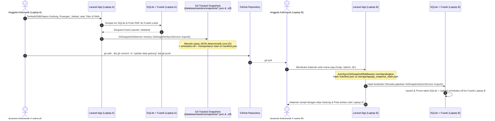

# ANALISIS MENDALAM FITUR TAMBAH GEDUNG, INVENTARIS CRUD & ARSITEKTUR AUTO-SYNC GIT
**Proyek:** USUClassMap / USUStarterMap (`D:\Documents\TUBES WEB SEMANTIK\Kelompok 3 Web Semantik\USUClassMap`)  
**Peran:** Principal Software Architect & Full-Stack Laravel + Semantic Web Engineer  
**Tanggal Audit:** 23 November 2026  
**Status Dokumen:** Read-Only Architectural Audit & Blueprint Desain (Belum Mengubah Kode Aplikasi)

---

## BAB 1: ANALISIS MENDALAM FITUR TAMBAH & KELOLA GEDUNG (ADMIN, SUPER ADMIN, & SPATIAL MAP)

Fitur pengelolaan data **Gedung Kampus (`Building`)** merupakan fondasi geospasial utama di `USUClassMap` karena setiap titik pin gedung di Peta User (`/map`), setiap Ruangan (`Room`), dan setiap Jadwal Kuliah (`Schedule`) bergantung pada entitas Gedung. Saat ini, sistem menyediakan **2 jalur antarmuka (Dual Entry-Points)** bagi Admin (`admin_usuclassmap` / `admin`) dan Super Admin (`superadmin`) untuk menambah serta mengelola gedung:

### 1.1 Jalur 1: Modul Manajemen Gedung Standar (`/admin/buildings/*`)
Dikelola oleh `App\Http\Controllers\Admin\BuildingController` dengan validasi `App\Http\Requests\Admin\BuildingRequest`:

1. **Rute & Endpoint:**
   - `GET /admin/buildings` (`admin.buildings.index`) → Menampilkan tabel daftar gedung (`withCount('rooms')`), pencarian nama/kode gedung, koordinat `(Lat, Lng)`, jumlah lantai, total ruangan, serta tombol Edit & modal konfirmasi Hapus.
   - `GET /admin/buildings/create` (`admin.buildings.create`) → Menampilkan halaman split-screen: **35% Panel Kiri (Form Vertikal)** dan **65% Panel Kanan (Peta Interaktif Mapbox 3D + HUD Standar Peta User + Auto-Fallback Leaflet 2D)**.
   - `POST /admin/buildings` (`admin.buildings.store`) → Memvalidasi input melalui `BuildingRequest`, menyimpan record baru via `Building::create($request->validated())`, men-dispatch `RegenerateRdfJob::dispatch()`, lalu me-redirect ke `admin.buildings.index`.
   - `GET /admin/buildings/{building}/edit` (`admin.buildings.edit`) → Menampilkan form edit gedung beserta peta interaktif dengan titik awal di koordinat gedung tersebut.
   - `PUT/PATCH /admin/buildings/{building}` (`admin.buildings.update`) → Memperbarui data gedung, men-dispatch `RegenerateRdfJob::dispatch()`, lalu me-redirect ke `admin.buildings.index`.
   - `DELETE /admin/buildings/{building}` (`admin.buildings.destroy`) → Menghapus gedung (`$building->delete()`), yang secara berantai menghapus ruangan dan jadwal terkait (`cascadeOnDelete`), lalu men-dispatch `RegenerateRdfJob::dispatch()`.

2. **Mekanisme Frontend ("The Magic UX" + HUD Peta User):**
   - Admin menentukan koordinat dengan **menggeser Pin Merah Draggable (`#DC2626`)** atau **mengklik area peta (`map.on('click')`)**.
   - Setiap pergerakan pin secara *real-time* mengisi input `<input id="latitude" name="latitude" readonly>` dan `<input id="longitude" name="longitude" readonly>` dengan presisi 7 desimal (`toFixed(7)`), sekaligus memperbarui pill indikator `#displayLat` dan `#displayLng`.
   - Dilengkapi 5 kontrol HUD di kanan atas peta: **Mode 3D/2D**, **Mode Satelit Google Hybrid (`lyrs=y`)** (otomatis menyembunyikan balok ekstrusi 3D abu-abu agar atap gedung terlihat tajam), **Reset Kamera**, **Layer Referensi 48 Gedung Kampus**, dan **Layer Referensi 31 Mitra Fotokopi**.

3. **Aturan Validasi (`App\Http\Requests\Admin\BuildingRequest`):**
   - `name`: `required|string|max:255`
   - `code`: `required|string|max:20|unique:buildings,code,{id}`
   - `faculty`: `nullable|string|max:100`
   - `latitude`: `required|numeric|between:-90,90`
   - `longitude`: `required|numeric|between:-180,180`
   - `description`: `nullable|string`
   - `floor_count`: `required|integer|min:1|max:20`

---

### 1.2 Jalur 2: Admin Spatial Map Dashboard (`/admin-sementara-/map`)
Dikelola oleh `App\Http\Controllers\AdminMapController` dengan tampilan `resources/views/features/admin/map.blade.php` dan engine `resources/js/features/admin/map.js`:

1. **Rute & Endpoint AJAX (JSON):**
   - `GET /admin-sementara-/map` (`admin.map.index`) → Merender dashboard spasial full-screen dengan sidebar kiri Alpine.js (`adminMapDashboard()`) dan kanvas peta kanan `#admin-map`.
   - `POST /admin-sementara-/map/building` (`admin.map.storeBuilding`) → Menerima payload JSON via `fetch()`, memvalidasi field (`code` max 30 karakter, unique), menyimpan via `Building::create($request->all())`, men-dispatch `RegenerateRdfJob::dispatch()`, dan mengembalikan JSON `{ success: true, building: {...} }`.
   - `PUT /admin-sementara-/map/building/{building}` (`admin.map.updateBuilding`) → Memperbarui gedung via AJAX, men-dispatch `RegenerateRdfJob::dispatch()`, dan mengembalikan JSON `{ success: true, building: $building->fresh() }`.

2. **Interaksi Event-Driven (Mapbox ↔ Alpine.js):**
   - Saat tab `"Gedung"` aktif dalam mode tambah baru, peta menampilkan **Pin Emas Draggable (`#D4A017`)**. Saat pin digeser (`dragend`) atau peta diklik (`click`), script mengirim `CustomEvent('coordinate-updated', { detail: { lat, lng } })` ke form Alpine.js.
   - Saat gedung berhasil dibuat, Alpine.js men-dispatch `CustomEvent('building-created-on-map', { detail: result.building })` sehingga pin hijau gedung baru langsung muncul di peta tanpa reload halaman.
   - Saat pin gedung hijau diklik atau tombol `"🎯 Pilih Konteks"` ditekan, pin berubah menjadi **Pin Edit Amber Draggable (`#f59e0b`)** dan form sidebar beralih ke mode Edit Gedung.

---

### 1.3 Skema Database `buildings`, Relasi Berantai, & Serialisasi RDF/SPARQL
1. **Struktur Tabel `buildings` (`2026_08_24_000002_create_buildings_table.php`):**
   - `id` (BigInt PK Auto-Increment)
   - `name` (String)
   - `code` (String, Unique Index)
   - `faculty` (String, Nullable)
   - `category` (String, Default: `'Fakultas'`)
   - `latitude` (Decimal 10,8)
   - `longitude` (Decimal 11,8)
   - `description` (Text, Nullable)
   - `floor_count` (Integer, Default: `1`)
   - `created_at`, `updated_at` (Timestamps)

2. **Dampak ke Peta User (`/api/buildings`) vs Triplestore RDF (`RdfGeneratorService`):**
   - **Peta User (`/api/buildings` — `Api\BuildingApiController@index`):** Membaca langsung dari tabel relasional `Building::with(['rooms', 'rooms.schedules.course', 'rooms.schedules.lecturer'])->orderBy('name')->get()`. Artinya, gedung baru yang ditambahkan Admin **langsung muncul sebagai pin di Peta User (`/map`)** meskipun gedung tersebut belum memiliki ruangan atau jadwal kuliah.
   - **Temuan Penting pada `RdfGeneratorService::generate()` (Baris 37–105):**
     Saat ini, `RdfGeneratorService::generate()` membangun grafik RDF (`storage/app/rdf/schedules.rdf`) dengan melakukan perulangan pada `Schedule::with(['course', 'lecturer', 'room.building'])->get()`.
     - **Konsekuensi:** Jika Admin baru saja menambahkan sebuah **Gedung baru** (atau **Ruangan baru**) yang **belum memiliki Jadwal Kuliah (`Schedule`)**, maka node `usu:Gedung` (`http://usuclassmap.usu.ac.id/resource/gedung/{id}`) tersebut **belum tertulis ke dalam `schedules.rdf` dan belum masuk ke Apache Jena Fuseki** sampai minimal ada 1 jadwal kuliah yang ditempatkan di gedung tersebut.
     - **Solusi Perbaikan (Dibahas di Bab 5):** `RdfGeneratorService::generate()` harus men-generate seluruh entitas `Building` (`usu:Gedung`) dan `Room` (`usu:Ruangan`) terlebih dahulu ke dalam `Graph` EasyRDF sebelum melakukan perulangan `Schedule`, sehingga gedung yang baru dibuat tanpa jadwal pun langsung eksis di triplestore Fuseki dan dapat ditemukan oleh query SPARQL (seperti `SparqlAsQuery::getBuildingStatsAs()`).

---

## BAB 2: MATRIKS INVENTARIS LENGKAP SELURUH FITUR CRUD & MUTASI DATA

Berikut adalah peta komprehensif seluruh fitur yang memodifikasi data (Create, Update, Delete, Import, Kalibrasi) di seluruh aplikasi `USUClassMap`, lengkap dengan lokasi penyimpanannya dan status pelacakannya di Git saat ini:

| No | Modul & Entitas Data | Role yang Berhak | Controller & Method Aksi | Route / Endpoint | Penyimpanan Primer (DB / File / Fuseki) | Penyimpanan Sekunder (Sync) | Status di Git Saat Ini (`git status`) |
|---|---|---|---|---|---|---|---|
| **1** | **Gedung Kampus (`Building`)** | Super Admin, Admin Akademik | `Admin\BuildingController@{store,update,destroy}` & `AdminMapController@{storeBuilding,updateBuilding}` | `/admin/buildings/*` & `/admin-sementara-/map/building*` | Tabel `buildings` di `database/database.sqlite` | `schedules.rdf` & Fuseki via `RegenerateRdfJob` | **IGNORED** (`database/.gitignore` mengabaikan `*.sqlite*`) |
| **2** | **Ruangan Kelas & Foto 360 (`Room`)** | Super Admin, Admin Akademik | `Admin\RoomController@{store,update,destroy}` & `AdminMapController@{storeRoom,updateRoom}` | `/admin/rooms/*` & `/admin-sementara-/map/room*` | Tabel `rooms` di `database/database.sqlite` + File foto di `storage/app/public/rooms/360/*` | `schedules.rdf` & Fuseki via `RegenerateRdfJob` | **IGNORED** (`*.sqlite*` & `storage/app/public/.gitignore` mengabaikan `*`) |
| **3** | **Multimedia & Hotspot 360 Ruangan (`RoomMedia`)** | Super Admin, Admin Akademik | `AdminMapController@{storeRoomMedia,updateMediaMetadata,destroyRoomMedia}` | `/admin-sementara-/map/rooms/{room}/media` & `/media/{media}*` | Tabel `room_media` di `database/database.sqlite` + File di `storage/app/public/room_media/*` | Sync kolom `photo_360_path` di tabel `rooms` | **IGNORED** (`*.sqlite*` & `storage/app/public/*`) |
| **4** | **Mata Kuliah (`Course`)** | Super Admin, Admin Akademik | `Admin\CourseController@{store,update,destroy}` & `AdminMapController@storeSchedule` (`course_mode=new`) | `/admin/courses/*` & `/admin-sementara-/map/schedule` | Tabel `courses` di `database/database.sqlite` | `schedules.rdf` & Fuseki saat terhubung ke jadwal | **IGNORED** (`*.sqlite*`) |
| **5** | **Dosen Pengajar (`Lecturer`)** | Super Admin, Admin Akademik | `Admin\LecturerController@{store,update,destroy}` | `/admin/lecturers/*` | Tabel `lecturers` di `database/database.sqlite` | `schedules.rdf` & Fuseki saat terhubung ke jadwal | **IGNORED** (`*.sqlite*`) |
| **6** | **Jadwal Kuliah (`Schedule`)** | Super Admin, Admin Akademik | `Admin\ScheduleController@{store,update,destroy}` & `AdminMapController@storeSchedule` | `/admin/schedules/*` & `/admin-sementara-/map/schedule` | Tabel `schedules` di `database/database.sqlite` | `ScheduleObserver` → `RegenerateRdfJob` → `storage/app/rdf/schedules.rdf` & Fuseki | **IGNORED** (`*.sqlite*` & `storage/app/.gitignore` mengabaikan `rdf/schedules.rdf`) |
| **7** | **Import Massal Jadwal Excel (`ScheduleImport`)** | Super Admin, Admin Akademik | `Admin\ImportController@store` | `POST /admin/import` | Tabel `buildings`, `rooms`, `courses`, `lecturers`, `schedules` di `database/database.sqlite` | `RegenerateRdfJob::dispatch()` 1x di akhir import | **IGNORED** (`*.sqlite*` & `storage/app/rdf/*`) |
| **8** | **Kalibrasi Orientasi Kamera 360° (`pitch` & `yaw`)** | Publik / Admin | `PhotoInspectorController@saveCalibration` | `POST /admin/cek-foto/kalibrasi` | **Hanya di Memori/TDB2 Apache Jena Fuseki** (`http://localhost:3030/usuclassmap/update`) | Tidak tersimpan di SQLite maupun file lokal | **IGNORED / VOLATILE** (Hilang jika container Fuseki di-reset / tidak terbawa ke laptop lain) |
| **9** | **Mitra Toko Fotokopi (`FotocopyStore` & `PhotocopyPlace`)** | Super Admin, Admin Fotokopi | `AdminFotokopi\StoreController@{store,update,destroy}` | `/admin-fotokopi/stores/*` | Tabel `fotocopy_stores` di `database/database.sqlite` | Auto-sync ke tabel `photocopy_places` di `database/database.sqlite` | **IGNORED** (`*.sqlite*`) |
| **10** | **Katalog & Tarif Layanan Fotokopi (`FotocopyService` & `PhotocopyItem`)** | Super Admin, Admin Fotokopi | `AdminFotokopi\ServiceController@{store,update,destroy}` | `/admin-fotokopi/services/*` | Tabel `fotocopy_services` di `database/database.sqlite` | Auto-sync ke tabel `photocopy_items` di `database/database.sqlite` | **IGNORED** (`*.sqlite*`) |
| **11** | **Pesanan Cetak Mahasiswa & POS Kasir (`FotocopyOrder`)** | Mahasiswa/Publik, Kasir Fotokopi, Super Admin | `PhotocopyController@{storeOrder,simulatePayment}` & `CashierFotokopi\OrderController@{storePos,updateStatus}` | `/fotocopy/{id}/order`, `/cashier-fotokopi/pos`, `/cashier-fotokopi/orders/{order}/status` | Tabel `fotocopy_orders` & `fotocopy_order_items` di `database/database.sqlite` + File lampiran `storage/app/public/fotocopy_docs/*` | - | **IGNORED** (`*.sqlite*` & `storage/app/public/*`) |
| **12** | **Akun Pengguna & Profil (`User`)** | Mahasiswa, Admin, Super Admin | `RegisteredUserController@store`, `ProfileController@{update,destroy}` | `/register`, `/profile` | Tabel `users` di `database/database.sqlite` + Foto profil di `storage/app/public/profile-photos/*` | - | **IGNORED** (`*.sqlite*` & `storage/app/public/*`) |

---

## BAB 3: ANALISIS AKAR MASALAH SINKRONISASI ANTAR LAPTOP (`git push` / `git pull`)

Ketika anggota kelompok bekerja secara kolaboratif menggunakan Git (misalnya **Laptop A** menambahkan 3 gedung baru, mengedit koordinat gedung FIB, menambahkan 2 ruangan beserta jadwal kuliah dan mitra fotokopi melalui antarmuka website, lalu melakukan `git add .`, `git commit`, dan `git push`), lalu anggota kelompok lain di **Laptop B** melakukan `git pull`, **data baru tersebut sama sekali tidak muncul di Laptop B**.

### 3.1 Lima Akar Masalah Teknis (Root Causes)
1. **Isolasi File Database Lokal (`USUClassMap/database/.gitignore`):**
   - Baris 1 pada `USUClassMap/database/.gitignore` berisi `*.sqlite*`.
   - Seluruh operasi CRUD yang dilakukan lewat UI website hanya memutasi file binary `USUClassMap/database/database.sqlite` di Laptop A. Karena file ini diabaikan oleh Git (dan memang file binary SQLite **tidak boleh** dimasukkan langsung ke Git karena akan menimbulkan *binary merge conflict* yang merusak database bila 2 orang mengedit bersamaan), Git tidak melihat adanya perubahan data sama sekali saat `git status`.
2. **Isolasi File Grafik RDF (`USUClassMap/storage/app/.gitignore`):**
   - File `USUClassMap/storage/app/.gitignore` berisi `*` (mengabaikan semua file dan subfolder kecuali `private/` dan `public/`).
   - Akibatnya, file `storage/app/rdf/schedules.rdf` yang di-generate oleh `RdfGeneratorService` setiap kali ada perubahan jadwal/gedung juga diabaikan oleh Git.
3. **Isolasi Triplestore Apache Jena Fuseki (`localhost:3030`):**
   - Server Apache Jena Fuseki berjalan sebagai service/Docker container lokal di masing-masing laptop. Meskipun Laptop B melakukan `git pull`, container Fuseki di Laptop B tidak otomatis menerima push RDF terbaru kecuali ada trigger di Laptop B yang mengunggah ulang RDF ke `http://localhost:3030/usuclassmap/data?default`.
4. **Kalibrasi Kamera 360° Hanya Hidup di Fuseki (`PhotoInspectorController`):**
   - Saat Admin melakukan kalibrasi sudut `pitch` dan `yaw` di `/admin/cek-foto`, `PhotoInspectorController@saveCalibration` hanya mengirim query `SPARQL DELETE/INSERT` langsung ke endpoint Fuseki lokal tanpa menyimpannya ke database SQLite maupun file JSON. Jika laptop lain melakukan `git pull`, kalibrasi kamera 360° tersebut tidak ikut berpindah.
5. **Seeder Statis Tidak Pernah Diperbarui oleh UI Web:**
   - File seeder yang dilacak Git (`database/seeders/BuildingSeeder.php`, `RoomSeeder.php`, `ScheduleSeeder.php`, `FotocopySeeder.php`, dll.) bersifat statis (ditulis manual di kode PHP). Perubahan lewat form web tidak pernah memperbarui isi seeder tersebut.

---

## BAB 4: DESAIN ARSITEKTUR *AUTO-SYNC GIT SNAPSHOT* (LAPTOP A `git push` → LAPTOP B `git pull` TERBARU)

Untuk mewujudkan pengalaman **"Ubah Data di Web Laptop A → Otomatis Terlacak Git → `git push` → Laptop B `git pull` → Otomatis Data & Fuseki Laptop B Terbaru Tanpa Perlu Command Manual"**, kita merancang arsitektur **Deterministic JSON Snapshot + Smart Hash-Check Auto-Import**.

### 4.1 Diagram Alur Arsitektur Auto-Sync Git Antar Laptop



---

### 4.2 Struktur Folder Snapshot yang Dilacak Git (`database/seeders/snapshots/`)
Karena folder `USUClassMap/database/seeders/` sudah **100% dilacak oleh Git** (tidak terkena aturan `*.sqlite*`), seluruh state data aplikasi diekspor secara otomatis ke dalam direktori `USUClassMap/database/seeders/snapshots/`:

```text
USUClassMap/database/seeders/snapshots/
├── manifest.json                  # Metadata versi, timestamp, & SHA-256 hash seluruh snapshot
├── buildings.json                 # Seluruh data tabel buildings (diurutkan berdasarkan id ASC)
├── rooms.json                     # Seluruh data tabel rooms (diurutkan berdasarkan id ASC)
├── room_media.json                # Seluruh data tabel room_media (foto, 360, video POV, hotspot)
├── courses.json                   # Seluruh data tabel courses
├── lecturers.json                 # Seluruh data tabel lecturers
├── schedules.json                 # Seluruh data tabel schedules
├── fotocopy_stores.json           # Seluruh data tabel fotocopy_stores (Panel Admin Fotokopi & Kasir)
├── photocopy_places.json          # Seluruh data tabel photocopy_places (Peta User & Direktori Publik)
├── fotocopy_services.json         # Seluruh data tabel fotocopy_services
├── photocopy_items.json           # Seluruh data tabel photocopy_items
├── photo_360_calibrations.json    # Backup kalibrasi pitch & yaw foto 360° dari Apache Jena Fuseki
└── schedules.rdf                  # Salinan RDF/XML lengkap (Gedung + Ruangan + Dosen + Matkul + Jadwal)
```

---

### 4.3 Mekanisme Sisi Laptop A: *Real-Time Auto-Export* Saat CRUD
1. **Observer Terpusat (`App\Observers\GitSnapshotObserver`):**
   - Dipasang pada event `saved` (`created` & `updated`) dan `deleted` untuk model-model berikut:
     `Building`, `Room`, `RoomMedia`, `Course`, `Lecturer`, `Schedule`, `FotocopyStore`, `PhotocopyPlace`, `FotocopyService`, dan `PhotocopyItem`.
   - Untuk operasi massal seperti **Import Excel (`ImportController@store`)**, observer dinonaktifkan selama perulangan baris dan `GitSnapshotSyncService::exportAll()` dipanggil tepat **satu kali** di akhir import.
2. **Format JSON Deterministik (Anti-Merge Conflict):**
   - Setiap tabel diekspor dengan `orderBy('id', 'asc')->get()->toArray()`.
   - Diserialisasi menggunakan `json_encode($rows, JSON_PRETTY_PRINT | JSON_UNESCAPED_UNICODE | JSON_UNESCAPED_SLASHES)`.
   - Karena setiap field berada di baris tersendiri dan terurut rapi menurut `id`, apabila Anggota A menambah Gedung X dan Anggota B mengedit Gedung Y, Git dapat menggabungkan (*auto-merge*) file `buildings.json` dengan mudah.
3. **Pembaruan `manifest.json`:**
   - Setiap kali ekspor selesai, `GitSnapshotSyncService` menghitung `content_hash` (SHA-256 dari seluruh file `.json` di folder `snapshots/`), menyimpannya ke `database/seeders/snapshots/manifest.json` (yang ikut di-commit ke Git), **dan** menyalin hash yang sama ke file lokal `storage/app/git_snapshot_state.json` (yang di-ignore Git) agar Laptop A tahu bahwa database lokalnya sendiri sudah sinkron.
4. **Pelacakan File Upload Foto 360° & Media Ruangan di Git:**
   - Memperbarui `USUClassMap/storage/app/public/.gitignore` agar mengecualikan folder media ruangan (`!rooms/`, `!rooms/360/`, `!rooms/360/**`, `!room_media/`, `!room_media/**`, `!foto360/`, `!foto360/**`, `!foto360p/`, `!foto360p/**`). Dengan demikian, saat Admin di Laptop A mengunggah foto 360° ruangan baru, file gambarnya ikut terbawa saat `git push`.

---

### 4.4 Mekanisme Sisi Laptop B: *Zero-Config Smart Hash-Check Auto-Import* Setelah `git pull`
Agar anggota kelompok di Laptop B **tidak perlu menghafal atau menjalankan perintah terminal manual** setiap habis `git pull`:

1. **Pengecekan Super Cepat (< 0.5 ms) di `AutoSyncGitSnapshotMiddleware`:**
   - Middleware ringan ini berjalan pada grup route `web` dan `api`.
   - Pada setiap request, middleware hanya membaca string `content_hash` dari `database/seeders/snapshots/manifest.json` (file hasil `git pull`) dan membandingkannya dengan string `last_imported_hash` di `storage/app/git_snapshot_state.json` (state lokal Laptop B).
   - **Jika hash sama:** Middleware langsung lanjut (`return $next($request)`) tanpa menyentuh database sama sekali (overhead ~0.2 milidetik).
   - **Jika hash berbeda (atau `git_snapshot_state.json` belum ada setelah `git pull`):** Middleware secara otomatis memanggil `GitSnapshotSyncService::importAll()`.

2. **Proses `GitSnapshotSyncService::importAll()` (Idempotent & Transaksional):**
   - Menggunakan *File Lock* (`Cache::lock('git_snapshot_sync', 30)`) agar tidak terjadi *race condition* bila beberapa request masuk bersamaan.
   - Selama proses import berlangsung, `GitSnapshotObserver` dan `ScheduleObserver` dinonaktifkan sementara (`Model::withoutEvents(...)`) agar tidak memicu *infinite loop* ekspor ulang.
   - Di dalam `DB::transaction(...)`:
     - Untuk setiap tabel (`buildings`, `rooms`, `room_media`, `courses`, `lecturers`, `schedules`, `fotocopy_stores`, `photocopy_places`, `fotocopy_services`, `photocopy_items`):
       - Melakukan **Upsert** seluruh baris dari file JSON (mempertahankan `id`, `code`, `latitude`, `longitude`, dan relasi foreign key secara utuh).
       - Melakukan **Prune (Penghapusan)** record di database lokal yang `id`-nya sudah tidak ada di file snapshot JSON (sehingga jika Laptop A menghapus sebuah gedung, gedung tersebut otomatis ikut terhapus di Laptop B setelah `git pull`).
   - Menyinkronkan ulang grafik RDF (`schedules.rdf`) dan kalibrasi kamera 360° (`photo_360_calibrations.json`) langsung ke server **Apache Jena Fuseki** lokal (`http://localhost:3030/usuclassmap`).
   - Menyimpan `content_hash` terbaru ke `storage/app/git_snapshot_state.json`.

3. **Integrasi dengan `php artisan db:seed` & Command Manual:**
   - `DatabaseSeeder.php` juga diperbarui: jika `database/seeders/snapshots/manifest.json` tersedia, maka `php artisan migrate:fresh --seed` akan langsung memuat snapshot terbaru dari `snapshots/*.json` (bukan lagi data awal yang sudah usang).
   - Tersedia pula command CLI `php artisan app:git-sync` (`--export` / `--import` / `--status`) untuk keperluan debugging atau eksekusi manual di terminal.

---

## BAB 5: BLUEPRINT RENCANA IMPLEMENTASI FILE-PER-FILE (TAHAP EKSEKUSI BERIKUTNYA)

Berikut adalah daftar file yang akan dibuat atau diperbarui pada tahap implementasi setelah dokumen analisis ini Anda setujui:

### 5.1 File Baru yang Akan Dibuat
| No | Path File Baru | Tanggung Jawab Utama |
|---|---|---|
| 1 | `USUClassMap/app/Services/GitSnapshotSyncService.php` | Service inti untuk mengekspor seluruh tabel CRUD & kalibrasi 360° ke `database/seeders/snapshots/*.json` + `schedules.rdf`, menghitung hash `manifest.json`, serta mengimpor snapshot secara otomatis ke SQLite & Apache Jena Fuseki saat hash berubah pasca `git pull`. |
| 2 | `USUClassMap/app/Observers/GitSnapshotObserver.php` | Eloquent Observer yang mendengarkan event `saved` dan `deleted` pada model-model CRUD (`Building`, `Room`, `RoomMedia`, `Course`, `Lecturer`, `Schedule`, `FotocopyStore`, `PhotocopyPlace`, `FotocopyService`, `PhotocopyItem`) untuk memicu auto-export snapshot. |
| 3 | `USUClassMap/app/Http/Middleware/AutoSyncGitSnapshotMiddleware.php` | Middleware otomatis pendeteksi perubahan hash `manifest.json` setelah `git pull` yang mengimpor data terbaru sebelum halaman web/API dirender. |
| 4 | `USUClassMap/app/Console/Commands/GitSyncSnapshotCommand.php` | Command Artisan `php artisan app:git-sync` untuk mengekspor snapshot awal, mengimpor manual, atau memeriksa status sinkronisasi Git. |
| 5 | `USUClassMap/database/seeders/snapshots/*.json` | File-file snapshot JSON awal yang langsung di-generate dari database aktif saat ini (48 gedung, 133 ruangan, jadwal, 31 toko fotokopi, 204 katalog layanan, kalibrasi 360°, dan `manifest.json`). |

### 5.2 File Eksisting yang Akan Diperbarui
| No | Path File Eksisting | Perubahan yang Akan Diterapkan |
|---|---|---|
| 1 | `USUClassMap/app/Services/RdfGeneratorService.php` | Memperbaiki `generate()` agar men-serialisasi seluruh `Building` (`usu:Gedung`) dan `Room` (`usu:Ruangan`) ke dalam `schedules.rdf` terlebih dahulu sebelum perulangan `Schedule`, sehingga gedung baru yang belum punya jadwal kuliah tetap langsung masuk ke RDF & Apache Jena Fuseki. |
| 2 | `USUClassMap/app/Http/Controllers/PhotoInspectorController.php` | Saat `saveCalibration()` menyimpan `pitch` & `yaw` ke Fuseki, sekaligus memperbarui file `database/seeders/snapshots/photo_360_calibrations.json` dan `manifest.json` agar kalibrasi kamera 360° ikut tersimpan ke Git. |
| 3 | `USUClassMap/app/Http/Controllers/Admin/ImportController.php` | Memanggil `app(GitSnapshotSyncService::class)->exportAll()` satu kali setelah proses import Excel selesai. |
| 4 | `USUClassMap/app/Providers/AppServiceProvider.php` | Mendaftarkan `GitSnapshotSyncService` sebagai singleton dan memasang `GitSnapshotObserver` pada ke-10 model CRUD utama. |
| 5 | `USUClassMap/bootstrap/app.php` | Mendaftarkan `AutoSyncGitSnapshotMiddleware` pada grup middleware `web` dan `api`. |
| 6 | `USUClassMap/database/seeders/DatabaseSeeder.php` | Menambahkan pengecekan agar jika snapshot `database/seeders/snapshots/manifest.json` ada, `db:seed` memuat data terbaru dari snapshot tersebut. |
| 7 | `USUClassMap/storage/app/public/.gitignore` | Membuka whitelist untuk folder media ruangan (`!rooms/`, `!room_media/`, `!foto360/`, `!foto360p/`) agar foto 360° gedung/ruangan yang diunggah lewat web ikut terlacak oleh Git. |
