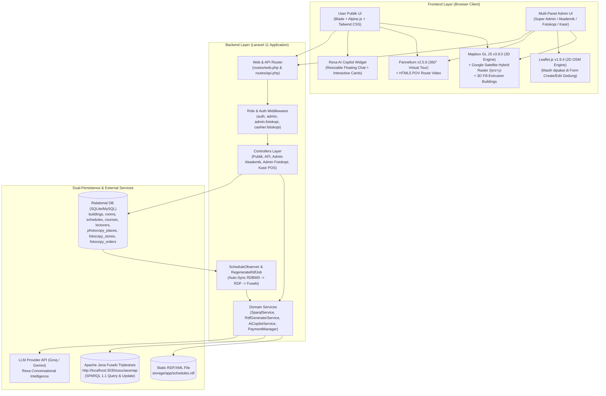

# ARSITEKTUR SISTEM & AUDIT KOMPREHENSIF: USER PUBLIK, SUPER ADMIN & MULTI-PANEL MAPS
**Proyek:** USUClassMap / USUStarterMap (`D:\Documents\TUBES WEB SEMANTIK\Kelompok 3 Web Semantik\USUClassMap`)  
**Peran:** Principal Software Architect & Full-Stack Laravel + Geospatial Engineer  
**Tanggal Audit:** 23 November 2026  
**Status Dokumen:** Read-Only Architectural & Feature Audit (Blueprint pra-eksekusi)  
**Prinsip Utama:**
1. **Peta User Publik (`/map`) Adalah Panduan Utama (Golden Standard)** — seluruh komponen peta di panel mana pun wajib mengacu pada standar engine, kontrol HUD (Mode Satelit Google Hybrid `lyrs=y`, Mode 3D, Reset Kamera, Layer 31 Mitra Fotokopi), dan ketahanan WebGL milik Peta User.
2. **Zero Feature Loss (Anti-Regresi)** — tidak boleh ada satu pun fitur spesifik Admin/Kasir (seperti *The Magic UX* draggable pin koordinat, klik peta isi `latitude`/`longitude`, tombol reset pin, CRUD gedung/ruangan/jadwal/toko fotokopi, maupun kalibrasi 360°) yang hilang atau rusak.

---

## 1. ARSITEKTUR SISTEM & TECH STACK KESELURUHAN

### 1.1 Diagram Alur Arsitektur (Dual-Persistence & Multi-Engine Geospatial)

### 1.2 Tech Stack Utama
| Lapisan | Teknologi / Pustaka | Peran dalam Sistem |
|---|---|---|
| **Backend Framework** | Laravel 11 (PHP 8.2+) | Routing, MVC, Authentication (Laravel Breeze), Validation, Job Queue, Eloquent ORM |
| **Frontend Bundler & UI** | Vite 6, Tailwind CSS v3/v4, Alpine.js v3 | Reactive state management, styling responsif, modal interaktif, sidebar filter |
| **Semantic Web & Triplestore** | Apache Jena Fuseki + EasyRDF (`easyrdf/easyrdf`) | Penyimpanan grafik pengetahuan RDF (`ucm:` ontology) & eksekusi SPARQL 1.1 (`SELECT`, `ASK`, `FILTER`, `OPTIONAL`, `REGEX`, `BIND/AS`) |
| **3D Geospatial Engine (Standar)** | Mapbox GL JS v3.9.0 + Google Satellite Hybrid (`lyrs=y`) | Peta kampus 3D interaktif (`pitch: 50`, `bearing: -15`), layer ekstrusi gedung 3D, citra satelit udara, custom HTML markers |
| **2D Geospatial Engine (Legacy Form)** | Leaflet.js v1.9.4 + OpenStreetMap Tiles | Saat ini masih digunakan pada halaman `/admin/buildings/create` dan `/admin/buildings/{id}/edit` |
| **Immersive Media Engine** | Pannellum 2.5.6 | Penampil panorama ruangan 360° (Equirectangular & Cylinder) beserta hotspot navigasi terkalibrasi SPARQL |
| **AI Conversational Engine** | `AiCopilotService` (LLM Tool-Use + Anti-Blindspot Search) | Asisten virtual **Rexa Copilot** yang terhubung langsung ke `SparqlService` dan kontrol kamera peta |
| **Payment & Document Engine** | `PaymentManager` (Strategy Pattern) + `maatwebsite/excel` | Pembayaran pesanan fotokopi (QRIS Dinamis SVG, Virtual Account/Transfer, Tunai) & Import/Export jadwal Excel |

---

### 1.3 Skema Role & Multi-Panel Access Control
Berdasarkan `app/Models/User.php`, `bootstrap/app.php`, dan ketiga middleware (`EnsureUserIsAdmin`, `EnsureUserIsAdminFotokopi`, `EnsureUserIsCashierFotokopi`), berikut matriks hak akses sistem:

| Role di Database (`users.role`) | Helper Method di `User.php` | Panel Akademik USU (`/admin/*`) | Panel Admin Fotokopi (`/admin-fotokopi/*`) | Panel Kasir & POS (`/cashier-fotokopi/*`) | Peta & Fitur Publik (`/map`, `/fotocopy`) | Redirect `/dashboard` |
|---|---|---|---|---|---|---|
| **`superadmin`** | `isSuperAdmin() = true` | **Akses Penuh** + Switcher Multi-Panel | **Akses Penuh** + Switcher Multi-Panel | **Akses Penuh** + Switcher Multi-Panel | Akses Penuh | `route('admin.dashboard')` |
| **`admin_usuclassmap`** / **`admin`** | `isAdmin() = true` | **Akses Penuh** | Akses Diizinkan (`isAdminFotokopi()` mencakup `admin_usuclassmap`) | Akses Diizinkan (`isCashierFotokopi()` mencakup `admin_usuclassmap`) | Akses Penuh | `route('admin.dashboard')` |
| **`admin_fotokopi`** | `isAdminFotokopi() = true` | Ditolak (Redirect `/login`) | **Akses Penuh** | Akses Diizinkan | Akses Penuh | `route('admin-fotokopi.dashboard')` |
| **`cashier_fotokopi`** | `isCashierFotokopi() = true` | Ditolak (Redirect `/login`) | Ditolak (Redirect `/login`) | **Akses Penuh** | Akses Penuh | `route('cashier-fotokopi.orders.index')` |
| **`mahasiswa` / `user` / Guest** | Semua admin helper `false` | Ditolak (Redirect `/login`) | Ditolak (Redirect `/login`) | Ditolak (Redirect `/login`) | **Akses Penuh** | `route('map')` |

---

## 2. INVENTARIS LENGKAP FITUR & ARSITEKTUR USER PUBLIK (PANDUAN UTAMA)

Sisi **User Publik** merupakan jantung aplikasi dan menjadi **Panduan Utama (Golden Standard)** bagi seluruh fitur spasial di dalam sistem.

### 2.1 Daftar Rute User Publik & API Terkait
| Method | URI | Route Name | Controller / Action | View / Output |
|---|---|---|---|---|
| `GET` | `/` | `home` | Closure | `features.landing.index` (Hero, Profil Mahasiswa, Tabel Bookmark Jadwal) |
| `GET` | `/map` | `map` | Closure | `features.map.index` (Peta Interaktif 3D Kampus USU) |
| `GET` | `/bookmarks` | `bookmarks` | Redirect | Redirect ke `/#bookmarks` |
| `GET` | `/faq` | `faq` | `FaqController@index` | `features.faq.index` |
| `POST` | `/copilot/chat` | `copilot.chat` | `AiCopilotController@chat` | JSON response Rexa Copilot (`throttle:20,1`) |
| `GET` | `/fotocopy` | `fotocopy.index` | `PhotocopyController@index` | `features.fotocopy.public.index` (Direktori 31 Mitra Fotokopi) |
| `GET` | `/fotocopy/{id}` | `fotocopy.show` | `PhotocopyController@show` | `features.fotocopy.public.show` (Detail Toko, Katalog, Jam Buka, Review) |
| `GET` | `/fotocopy/{id}/order` | `fotocopy.order` | `PhotocopyController@order` | `features.fotocopy.public.order` (Form Kalkulator Pesanan Cetak) |
| `POST` | `/fotocopy/{id}/order` | `fotocopy.order.store` | `PhotocopyController@storeOrder` | Simpan pesanan & redirect ke halaman instruksi pembayaran |
| `GET` | `/fotocopy/orders/{orderCode}/payment` | `fotocopy.orders.payment` | `PhotocopyController@paymentInstructions` | `features.fotocopy.public.payment` (QRIS SVG, VA, Simulasi Lunas) |
| `POST` | `/fotocopy/orders/{orderCode}/simulate-payment` | `fotocopy.orders.simulate-payment` | `PhotocopyController@simulatePayment` | JSON update status `paid` & `Diproses` |
| `GET` | `/api/buildings` | `api.buildings.index` | `Api\BuildingApiController@index` | JSON daftar 48 gedung + ruangan + jadwal + foto 360 |
| `GET` | `/api/buildings/{building}` | `api.buildings.show` | `Api\BuildingApiController@show` | JSON detail 1 gedung beserta ruangan dan jadwalnya |
| `GET` | `/api/schedules/search` | `api.schedules.search` | `Api\ScheduleApiController@search` | JSON hasil pencarian jadwal SPARQL (`q`, `day`) |
| `GET` | `/api/sparql/regex-search` | `api.sparql.regex` | `Api\ScheduleApiController@regexSearch` | JSON hasil pencarian konsep **SPARQL REGEX** |
| `GET` | `/api/sparql/check-room` | `api.sparql.check-room` | `Api\ScheduleApiController@checkRoom` | JSON boolean hasil konsep **SPARQL ASK (YES/NO Query)** |
| `GET` | `/api/sparql/building-stats` | `api.sparql.building-stats` | `Api\ScheduleApiController@buildingStats` | JSON agregasi hasil konsep **SPARQL AS (`COUNT` & `BIND`)** |
| `GET` | `/api/copy-shops` | `api.copy-shops.index` | `Api\CopyShopApiController@index` | JSON koleksi `CopyShopResource` (31 mitra fotokopi) |
| `GET` | `/api/copy-shops/services` | `api.copy-shops.services` | `Api\CopyShopApiController@services` | JSON daftar master layanan fotokopi |
| `GET` | `/api/copy-shops/{id}` | `api.copy-shops.show` | `Api\CopyShopApiController@show` | JSON detail 1 mitra fotokopi |
| `GET` | `/api/my-schedules` | `api.my-schedules` | `ScheduleController@mySchedules` | JSON jadwal terpersonalisasi bagi mahasiswa yang login |

### 2.2 Spesifikasi Teknis Peta User (`/map`) — Standar Emas Spasial
Ditopang oleh `resources/views/features/map/index.blade.php` dan `resources/js/features/map.js`:
1. **Konfigurasi Kamera & Engine:**
   - Engine: **Mapbox GL JS v3.9.0** (`mapbox://styles/mapbox/streets-v12`).
   - Titik Pusat Kampus USU: `DEFAULT_CENTER = [98.656520, 3.565245]` (`[lng, lat]`), `DEFAULT_ZOOM = 16`, `DEFAULT_PITCH = 50`, `DEFAULT_BEARING = -15`.
2. **4 Kontrol Floating Spatial HUD (Kanan Atas Peta):**
   - **Mode 3D / Mode 2D (`togglePerspective`):** Mengubah kemiringan kamera (`pitch: 50, bearing: -15` ↔ `pitch: 0, bearing: 0`) dan visibilitas layer ekstrusi `3d-buildings`.
   - **Mode Satelit (`toggleSatelliteMode`):** Menampilkan/menyembunyikan raster layer **Google Satellite Hybrid** (`https://mt0.google.com/vt/lyrs=y&x={x}&y={y}&z={z}` s/d `mt3`, `tileSize: 256`) dengan `map.setLayoutProperty('google-satellite-layer', 'visibility', ...)` **tanpa pernah memanggil `map.setStyle()`** (sehingga bebas *WebGL context loss*). Saat Mode Satelit aktif, layer `3d-buildings` otomatis disembunyikan (`visibility: 'none'`) agar foto udara atap gedung kampus USU terlihat bersih; preferensi disimpan di `localStorage` (`usuclassmap_satellite_mode`).
   - **Reset Kamera (`resetCampusView`):** Animasi `map.flyTo` kembali ke koordinat, zoom, pitch, dan bearing default Kampus USU.
   - **Layer Fotokopi (31) (`togglePhotocopyLayer`):** Memuat 31 mitra fotokopi dari `/api/copy-shops?per_page=50`, merender custom pill marker hijau-cyan (`createPhotocopyMarkerElement`), dilengkapi popup status Buka/Tutup, rating Google, alamat, tombol `"Lihat & Pesan"`, serta tombol chat WhatsApp.
3. **Ketahanan WebGL (WebGL Resilience & Anti-Crash):**
   - Opsi `failIfMajorPerformanceCaveat: false` pada konstruktor `new mb.Map(...)`.
   - Pre-check `mb.supported({ failIfMajorPerformanceCaveat: false })`.
   - Singleton instance guard (`window.__usuMapInstance`) yang memanggil `.remove()` sebelum re-inisialisasi, ditambah listener `window.addEventListener('beforeunload', ...)` untuk melepas konteks WebGL saat refresh.
   - Penjamin dimensi eksplisit container (`min-h-[400px]`, pengecekan `clientWidth`/`clientHeight`).
   - UI Fallback (`renderFallbackMapError`) dengan tombol **"Muat Ulang Peta"** (`retryInitMap`) jika GPU/WebGL bermasalah.
4. **Pencarian Semantik 5 Konsep SPARQL 1.1 & Rexa AI Copilot:**
   - Multi-token semantic search (`SparqlService::searchSchedules`) yang menggabungkan **FILTER**, **OPTIONAL**, **REGEX** (`SparqlRegexQuery`), **ASK** (`SparqlAskQuery`), dan **AS** (`SparqlAsQuery`), dilengkapi *Eloquent Fallback* otomatis jika server Fuseki sedang mati.
   - **Rexa Copilot (`AiCopilotService` + `resources/js/copilot.js`):** Mendukung *Human Sensitivity Layer* (koreksi salah ingat singkatan fakultas seperti `FEB` ↔ `FIB`), kamus alias gedung USU, pengelompokan jadwal multi-fakultas, kartu jadwal interaktif yang memicu `flyTo` kamera peta, dan jendela chat *drag-to-resize*.

---

## 3. INVENTARIS LENGKAP FITUR & ARSITEKTUR SUPER ADMIN & MULTI-PANEL

### 3.1 Super Admin & Navigasi Multi-Panel
Ketika pengguna login dengan akun ber-role `superadmin` (`User::isSuperAdmin() === true`), sistem mengaktifkan fitur **Universal Control Hub**:
1. **Sidebar Switcher ("Akses Multi-Panel — Super"):** Tersedia secara konsisten di puncak sidebar pada ketiga layout (`components/layouts/admin.blade.php`, `components/layouts/admin-fotokopi.blade.php`, dan `components/layouts/cashier-fotokopi.blade.php`). Memungkinkan perpindahan instan 1-klik antar:
   - **Panel Akademik USU** (`route('admin.dashboard')`)
   - **Panel Admin Fotokopi** (`route('admin-fotokopi.dashboard')`)
   - **Panel Kasir & POS** (`route('cashier-fotokopi.orders.index')`)
2. **Kartu Universal Hub di Dashboard Akademik (`features/admin/dashboard.blade.php`):** Menampilkan 3 kartu modul operasional dengan indikator `"Mode Universal Aktif"`.

---

### 3.2 Panel Akademik USU (`/admin/*` & `/admin-sementara-/map`)
Dikelola oleh grup route `admin.` (middleware `['auth', 'admin']`) dan menggunakan layout `x-layouts.admin`:

| Sub-Menu / Fitur | Route Name & URI | Controller | File View Aktif | Deskripsi Fungsionalitas & Sinkronisasi RDF |
|---|---|---|---|---|
| **Dashboard Akademik** | `admin.dashboard` (`/admin/dashboard`) | `Admin\DashboardController@index` | `features/admin/dashboard.blade.php` | Statistik total jadwal, dosen, gedung (48), ruangan (133), 5 jadwal terbaru, & Super Admin Hub. |
| **Jadwal Kuliah (CRUD)** | `admin.schedules.*` (`/admin/schedules`) | `Admin\ScheduleController` | `features/admin/schedules/{index,create,edit}.blade.php` | CRUD jadwal kuliah. Setiap `created`, `updated`, `deleted` pada model `Schedule` memicu `ScheduleObserver` -> `RegenerateRdfJob` -> regenerasi `schedules.rdf` & push SPARQL ke Apache Jena Fuseki. |
| **Dosen (CRUD)** | `admin.lecturers.*` (`/admin/lecturers`) | `Admin\LecturerController` | `features/admin/lecturers/{index,create,edit}.blade.php` | CRUD data dosen pengajar (Nama, NIP, Email, Fakultas). |
| **Gedung Kampus (CRUD + Peta)** | `admin.buildings.*` (`/admin/buildings`) | `Admin\BuildingController` | `features/admin/buildings/{index,create,edit}.blade.php` | CRUD gedung kampus beserta penentuan koordinat GPS `latitude` & `longitude` melalui peta interaktif (saat ini masih memakai **Leaflet 2D**). |
| **Ruangan & Foto 360 (CRUD)** | `admin.rooms.*` (`/admin/rooms`) | `Admin\RoomController` | `features/admin/rooms/{index,create,edit}.blade.php` | CRUD ruangan per gedung (lantai, kapasitas) + upload foto panorama 360° (`rooms/360`) + modal pratinjau cepat foto 360° di tabel index. |
| **Mata Kuliah (CRUD)** | `admin.courses.*` (`/admin/courses`) | `Admin\CourseController` | `features/admin/courses/{index,create,edit}.blade.php` | CRUD mata kuliah (Kode, Nama, SKS, Tipe MKWU/MKWK, Semester). |
| **Import Excel Jadwal** | `admin.import.*` (`/admin/import`) | `Admin\ImportController` | `features/admin/import/index.blade.php` | Upload massal jadwal `.xlsx/.xls/.csv` via `ScheduleImport` (menonaktifkan observer per-baris dan men-dispatch `RegenerateRdfJob` 1 kali di akhir import) + unduh template Excel. |
| **360° Photo Inspector** | `admin.cek-foto` (`/admin/cek-foto`) & `admin.cek-foto-p` (`/admin/cek-foto-p`) | `PhotoInspectorController` | `features/admin/cek-foto.blade.php` & `cek-foto-p.blade.php` | Alat kalibrasi orientasi awal kamera panorama 360° (`pitch` & `yaw`) menggunakan Pannellum, membaca & menyimpan nilai kalibrasi langsung ke triplestore **Apache Jena Fuseki** via `SPARQL SELECT` (`OPTIONAL`) dan `SPARQL DELETE/INSERT`. |
| **Admin Spatial Map Dashboard** | `admin.map.*` (`/admin-sementara-/map`) | `AdminMapController` | `features/admin/map.blade.php` + `resources/js/features/admin/map.js` | Dashboard spasial terpadu berbasis **Mapbox GL JS 3D** (telah disinkronkan dengan HUD Peta User) untuk manajemen gedung, ruangan, jadwal, dan hotspot 360° secara langsung di atas peta. |

---

### 3.3 Panel Admin Fotokopi (`/admin-fotokopi/*`)
Dikelola oleh grup route `admin-fotokopi.` (middleware `['auth', 'admin.fotokopi']`) dan menggunakan layout `x-layouts.admin-fotokopi`:

| Sub-Menu / Fitur | Route Name & URI | Controller | File View Aktif | Deskripsi Fungsionalitas |
|---|---|---|---|---|
| **Dashboard Admin Fotokopi** | `admin-fotokopi.dashboard` (`/admin-fotokopi/dashboard`) | `AdminFotokopi\DashboardController@index` | `features/fotocopy/admin/dashboard.blade.php` | Ringkasan metrik: Total Mitra Toko (31), Total Katalog Layanan (204), Total Pesanan, Estimasi Omzet Lunas, chip status pesanan (Menunggu, Diproses, Selesai), daftar pesanan terbaru, & Top 5 toko. |
| **Mitra Toko Fotocopy (CRUD)** | `admin-fotokopi.stores.*` (`/admin-fotokopi/stores`) | `AdminFotokopi\StoreController` | `features/fotocopy/admin/stores/{index,create,edit}.blade.php` | CRUD gerai mitra fotokopi: Nama Toko, Lokasi Kampus, Jam & Hari Operasional, WhatsApp, Instagram, Facebook, Harga Mulai, Rating, Status Buka/Tutup, penugasan Akun Kasir (`user_id`), serta input **Latitude Peta & Longitude Peta**. |
| **Katalog & Daftar Harga (CRUD)** | `admin-fotokopi.services.*` (`/admin-fotokopi/services`) | `AdminFotokopi\ServiceController` | `features/fotocopy/admin/services/{index,create,edit}.blade.php` | CRUD item layanan per toko dengan filter per toko & kategori (`Print`, `Fotocopy`, `Jilid`, `ATK`), harga, satuan (`lembar`, `jilid`, `paket`), dan status ketersediaan. |
| **Laporan & Transaksi** | `admin-fotokopi.reports.index` (`/admin-fotokopi/reports`) | `AdminFotokopi\ReportController@index` | `features/fotocopy/admin/reports/index.blade.php` | Rekapitulasi seluruh pesanan lintas toko dengan filter Toko, Status Pesanan, Metode Pembayaran (`qris`, `bank_transfer`, `cash`), pencarian kode/nama pelanggan, serta kalkulasi total transaksi & omzet lunas. |

---

### 3.4 Panel Kasir & POS (`/cashier-fotokopi/*`)
Dikelola oleh grup route `cashier-fotokopi.` (middleware `['auth', 'cashier.fotokopi']`) dan menggunakan layout `x-layouts.cashier-fotokopi`:

| Sub-Menu / Fitur | Route Name & URI | Controller | File View Aktif | Deskripsi Fungsionalitas |
|---|---|---|---|---|
| **Antrean Pesanan Masuk** | `cashier-fotokopi.orders.index` (`/cashier-fotokopi/orders`) | `CashierFotokopi\OrderController@index` | `features/fotocopy/cashier/orders/index.blade.php` | Menampilkan antrean pesanan untuk toko yang dikelola kasir (`FotocopyStore::where('user_id', $user->id)`), tab filter status (`Semua`, `Menunggu`, `Sedang Diproses`, `Selesai`), kontak WA pemesan, rincian item, dan pratinjau lampiran dokumen. |
| **Update Status & Pembayaran** | `cashier-fotokopi.orders.status` (`PATCH /cashier-fotokopi/orders/{order}/status`) | `CashierFotokopi\OrderController@updateStatus` | Redirect back dengan flash message | Mengubah status pengerjaan (`Menunggu` -> `Diproses` -> `Selesai` / `Dibatalkan`). Saat ditandai `Selesai`, otomatis meng-update `payment_status = 'paid'`. |
| **Unduh Lampiran File Cetak** | `cashier-fotokopi.orders.file` (`/cashier-fotokopi/orders/{order}/file`) | `CashierFotokopi\OrderController@downloadFile` | File stream download | Mengunduh file dokumen (`storage/app/public/fotocopy_docs/...`) yang diunggah pelanggan/kasir. |
| **Cetak SPK & Nota Kasir** | `cashier-fotokopi.orders.print` (`/cashier-fotokopi/orders/{order}/print`) | `CashierFotokopi\OrderController@printJob` | `features/fotocopy/cashier/orders/print.blade.php` | Halaman cetak Surat Perintah Kerja (SPK) produksi & struk bukti pembayaran kasir. |
| **Input Kasir (POS Walk-in)** | `cashier-fotokopi.orders.pos` (`GET/POST /cashier-fotokopi/pos`) | `CashierFotokopi\OrderController@createPos` & `storePos` | `features/fotocopy/cashier/orders/pos.blade.php` | Antarmuka Point-of-Sale interaktif (Alpine.js `posApp()`) untuk mencatat pelanggan walk-in di meja kasir, memilih item katalog toko, mengatur kuantitas, unggah file dari flashdisk, pilih pembayaran (`Tunai`, `QRIS`, `Transfer`), dan cetak langsung (`POS-YYYYMMDD-XXXX`). |

---

## 4. AUDIT KOMPREHENSIF SELURUH HALAMAN PETA (MAPS) & MATRIKS KESENJANGAN

### 4.1 Inventaris Seluruh Halaman yang Memiliki Komponen Peta / Koordinat Spasial

Dari hasil pemindaian seluruh direktori `resources/views/` dan `resources/js/`, terdapat **6 area halaman aktif** (beserta file salinan legacy-nya) yang memuat komponen peta atau input koordinat geospasial:

| No | Nama Halaman & Panel | URI / Route | File Blade Aktif (& Legacy Copy) | Engine Peta Saat Ini | Cara Kerja Saat Ini |
|---|---|---|---|---|---|
| **1** | **Peta Kampus 3D (User Publik — PANDUAN UTAMA)** | `GET /map` (`map`) | `resources/views/features/map/index.blade.php` *(Legacy: `resources/views/map/index.blade.php`)* JS: `resources/js/features/map.js` | **Mapbox GL JS v3.9.0 (3D)** | Peta 3D penuh dengan HUD Mode 3D/2D, Mode Satelit Google Hybrid (`lyrs=y`), Reset Kamera, Layer 31 Fotokopi, 48 Pin Gedung, Pencarian SPARQL, Rexa Copilot, & WebGL Singleton Guard. |
| **2** | **Admin Spatial Map Dashboard** | `GET /admin-sementara-/map` (`admin.map.index`) | `resources/views/features/admin/map.blade.php` *(Legacy: `resources/views/admin/map.blade.php`)* JS: `resources/js/features/admin/map.js` | **Mapbox GL JS v3.9.0 (3D)** *(Sudah Sinkron)* | Telah disinkronkan dengan Peta User: memiliki HUD Mode 3D/2D, Mode Satelit Google Hybrid, Reset Kamera, Layer 31 Fotokopi, WebGL Guard, ditambah Draggable Gold/Amber Marker untuk CRUD gedung/ruangan/jadwal/360°. |
| **3** | **Tambah Gedung Baru (Panel Akademik USU)** | `GET /admin/buildings/create` (`admin.buildings.create`) | `resources/views/features/admin/buildings/create.blade.php` *(Legacy: `resources/views/admin/buildings/create.blade.php`)* | **Leaflet.js v1.9.4 (2D OSM)** *(BELUM SINKRON)* | Layout split 35% form / 65% peta `#buildingMap`. Memakai tile 2D OpenStreetMap biasa. Memiliki pin merah draggable (*The Magic UX*), klik peta pindah pin, dan tombol *"Pusatkan ke Kampus USU"*. Belum punya Mode Satelit, Mode 3D, ataupun layer referensi gedung/fotokopi. |
| **4** | **Edit Gedung Kampus (Panel Akademik USU)** | `GET /admin/buildings/{building}/edit` (`admin.buildings.edit`) | `resources/views/features/admin/buildings/edit.blade.php` *(Legacy: `resources/views/admin/buildings/edit.blade.php`)* | **Leaflet.js v1.9.4 (2D OSM)** *(BELUM SINKRON)* | Layout split 35% form / 65% peta `#buildingMap`. Memakai tile 2D OpenStreetMap biasa. Memiliki pin merah draggable pada koordinat gedung, klik peta pindah pin, dan tombol *"Kembalikan ke Posisi Awal"*. Belum punya Mode Satelit, Mode 3D, ataupun layer referensi gedung/fotokopi. |
| **5** | **Tambah Mitra Toko Fotocopy (Panel Admin Fotokopi)** | `GET /admin-fotokopi/stores/create` (`admin-fotokopi.stores.create`) | `resources/views/features/fotocopy/admin/stores/create.blade.php` *(Legacy: `resources/views/admin-fotokopi/stores/create.blade.php`)* | **TANPA PETA (Input Angka Manual)** *(BELUM SINKRON)* | Hanya menyediakan 2 kolom `<input type="number" name="latitude">` dan `<input type="number" name="longitude">`. Admin harus mengetik angka desimal koordinat GPS secara manual tanpa visualisasi peta sama sekali. |
| **6** | **Edit Mitra Toko Fotocopy (Panel Admin Fotokopi)** | `GET /admin-fotokopi/stores/{store}/edit` (`admin-fotokopi.stores.edit`) | `resources/views/features/fotocopy/admin/stores/edit.blade.php` *(Legacy: `resources/views/admin-fotokopi/stores/edit.blade.php`)* | **TANPA PETA (Input Angka Manual)** *(BELUM SINKRON)* | Hanya menyediakan 2 kolom `<input type="number" name="latitude">` dan `<input type="number" name="longitude">` tanpa kanvas peta interaktif untuk menggeser/memilih titik lokasi toko. |

*(Catatan Tambahan: Halaman `/admin/cek-foto` dan `/admin/cek-foto-p` menggunakan engine **Pannellum 2.5.6** untuk kalibrasi koordinat bola/silinder panorama 360° `pitch` & `yaw` ke Apache Jena Fuseki, sedangkan `/fotocopy/{id}` menyediakan tombol eksternal `"Pergi ke Maps"` menuju Google Maps Directions).*

---

### 4.2 Matriks Perbandingan Fitur Peta: User (Panduan) vs Seluruh Halaman Admin

| Parameter / Fitur Standar | 1. Peta User (`/map`) **[PANDUAN]** | 2. Admin Spatial Map (`/admin-sementara-/map`) | 3. Admin Create Gedung (`/admin/buildings/create`) | 4. Admin Edit Gedung (`/admin/buildings/{id}/edit`) | 5. Admin Fotokopi Create Toko (`/admin-fotokopi/stores/create`) | 6. Admin Fotokopi Edit Toko (`/admin-fotokopi/stores/{id}/edit`) |
|---|---|---|---|---|---|---|
| **Engine Utama** | Mapbox GL JS v3.9.0 (3D) | Mapbox GL JS v3.9.0 (3D) | **Leaflet 1.9.4 (2D OSM)** | **Leaflet 1.9.4 (2D OSM)** | **Tidak Ada Peta** | **Tidak Ada Peta** |
| **Style Dasar & Kamera USU** | `streets-v12`, Pitch 50, Bearing -15 | `streets-v12`, Pitch 50, Bearing -15 | OSM 2D Flat (Zoom 17) | OSM 2D Flat (Zoom 17) | - | - |
| **Toggle Mode Satelit (`lyrs=y`)** | **Ada** (Google Hybrid + Auto-Hide 3D) | **Ada** (Sudah Sinkron) | **Belum Ada** | **Belum Ada** | **Belum Ada** | **Belum Ada** |
| **Toggle Mode 3D / 2D** | **Ada** (Extrusi 3D `#d1d5db`) | **Ada** (Sudah Sinkron) | **Belum Ada** | **Belum Ada** | **Belum Ada** | **Belum Ada** |
| **Tombol Reset Kamera** | **Ada** (`flyTo` Kampus USU) | **Ada** (Sudah Sinkron) | Ada (`panTo` Kampus USU) | Ada (`panTo` Posisi Awal) | **Belum Ada** | **Belum Ada** |
| **Layer 31 Mitra Fotokopi** | **Ada** (Toggle HUD `Fotokopi (31)`) | **Ada** (Sudah Sinkron) | **Belum Ada** | **Belum Ada** | **Belum Ada** | **Belum Ada** |
| **Pin Konteks Gedung Kampus** | **Ada** (48 Gedung USU) | **Ada** (48 Gedung USU) | **Belum Ada** (Hanya 1 pin) | **Belum Ada** (Hanya 1 pin) | **Belum Ada** | **Belum Ada** |
| **Draggable Pin Ambil Lat/Lng** | Tidak (Read-Only User) | **Ada** (Pin Emas/Amber) | **Ada** (Pin Merah `#DC2626`) | **Ada** (Pin Merah `#DC2626`) | **Belum Ada** (Ketik Manual) | **Belum Ada** (Ketik Manual) |
| **Klik Peta Pindahkan Pin & Lat/Lng** | Tidak (Read-Only User) | Drag Marker | **Ada** (`map.on('click')`) | **Ada** (`map.on('click')`) | **Belum Ada** | **Belum Ada** |
| **WebGL Singleton Guard & Fallback** | **Ada** (`beforeunload` + Fallback UI) | **Ada** (Sudah Sinkron) | Hanya 2D Leaflet | Hanya 2D Leaflet | - | - |
| **Keamanan Token `.env`** | Aman (`VITE_MAPBOX_ACCESS_TOKEN`) | Aman (`VITE_MAPBOX_ACCESS_TOKEN`) | Tidak pakai token | Tidak pakai token | - | - |

---

### 4.3 Daftar Fitur Spesifik Admin yang Wajib Dikunci (Zero Feature Loss)

Saat menyinkronkan halaman-halaman di atas agar mengadopsi standar Peta User, fitur-fitur khusus Admin berikut **HARUS DIKUNCI 100% (Dilarang Hilang/Rusak)**:

1. **Pada `/admin/buildings/create` & `/admin/buildings/{building}/edit` (Panel Akademik USU):**
   - **Layout Split 35% Form Kiri / 65% Peta Kanan (`#buildingMap`):** Proporsi dan struktur form (`name`, `code`, `faculty`, `latitude`, `longitude`, `floor_count`, `description`) wajib tetap utuh.
   - **"The Magic UX" Real-Time Coordinate Sync:**
     - Input `#latitude` dan `#longitude` (Read-Only) serta indikator floating pill `#displayLat` dan `#displayLng` wajib langsung ter-update secara *real-time* baik saat **pin merah (`#DC2626`) digeser (`drag` / `dragend`)** maupun saat **area peta diklik (`click`)**.
   - **Tombol Reset Kontekstual (`#resetPinBtn`):**
     - Pada halaman `create`: Tombol **"Pusatkan ke Kampus USU"** mengembalikan pin merah dan kamera ke titik pusat USU (`3.5652417, 98.6568434`).
     - Pada halaman `edit`: Tombol **"Kembalikan ke Posisi Awal"** mengembalikan pin merah dan kamera ke koordinat asli gedung (`$building->latitude, $building->longitude`) sebelum diedit.
   - **Auto-Fallback ke Leaflet 2D:** Jika browser admin mengalami kegagalan inisialisasi WebGL pada Mapbox 3D, peta pada form gedung dapat otomatis jatuh (auto-fallback) ke engine Leaflet 2D sehingga admin tetap bisa memilih titik koordinat gedung tanpa terhambat.

2. **Pada `/admin-fotokopi/stores/create` & `/admin-fotokopi/stores/{store}/edit` (Panel Admin Fotokopi):**
   - Seluruh field form (`name`, `location_name`, `opening_hours`, `operating_days`, `whatsapp`, `instagram`, `facebook`, `starting_price`, `rating`, `is_open`, `user_id` kasir, `latitude`, `longitude`, `description`) wajib tetap berfungsi penuh.
   - Input `latitude` dan `longitude` tetap dapat diedit manual **DAN** terhubung dua arah (*two-way binding*) dengan **Peta Interaktif Mapbox 3D** baru (geser pin toko / klik peta otomatis mengisi input `latitude` & `longitude`, dan mengetik angka di input otomatis memindahkan pin di peta).

3. **Pada `/admin-sementara-/map` (Admin Spatial Map Dashboard):**
   - Seluruh fitur yang baru saja disinkronkan (Draggable Gold Pin gedung baru, Draggable Amber Pin edit gedung, CRUD ruangan/jadwal/multimedia 360°, serta HUD Mode 3D, Mode Satelit, Reset Kamera, dan Fotokopi 31) wajib tetap terjaga.

---

## 5. ANALISIS KESENJANGAN BACKEND, PAYLOAD API & KEAMANAN KONFIGURASI

### 5.1 Temuan Krusial: Kesenjangan Dual-Table Fotokopi (`FotocopyStore` vs `PhotocopyPlace`)
Hasil audit mendalam pada layer Model dan Controller mengungkap adanya **pemisahan tabel (Dual-Table Desynchronization)** pada modul Fotokopi:

1. **Tabel yang Dipakai Panel Admin Fotokopi & Kasir POS:**
   - `AdminFotokopi\StoreController` membaca dan menulis ke model **`FotocopyStore`** (tabel `fotocopy_stores` — 31 baris).
   - `AdminFotokopi\ServiceController` membaca dan menulis ke model **`FotocopyService`** (tabel `fotocopy_services` — 204 baris).
   - `CashierFotokopi\OrderController` membaca toko dari **`FotocopyStore`** dan layanan dari **`FotocopyService`**, serta menyimpan transaksi ke **`FotocopyOrder`** (`fotocopy_orders`).
2. **Tabel yang Dipakai Peta User (`/map`), Peta Admin, & Halaman Direktori Fotokopi Publik (`/fotocopy`):**
   - `Api\CopyShopApiController` (`/api/copy-shops`) membaca dari model **`PhotocopyPlace`** (tabel `photocopy_places` — 31 baris) melalui `CopyShopResource`.
   - `PhotocopyController` (`/fotocopy`, `/fotocopy/{id}`, `/fotocopy/{id}/order`) membaca dari model **`PhotocopyPlace`** dan **`PhotocopyItem`** (tabel `photocopy_items` — 204 baris).
3. **Dampak Kesenjangan Saat Ini:**
   - Ketika Super Admin atau Admin Fotokopi menambah toko baru, mengubah titik koordinat `latitude`/`longitude`, mengubah status buka/tutup, atau memperbarui harga katalog di **Panel Admin Fotokopi** (`/admin-fotokopi/stores` atau `/admin-fotokopi/services`), perubahan tersebut **hanya tersimpan di `fotocopy_stores` / `fotocopy_services`**, tetapi **tidak ter-update di `photocopy_places` / `photocopy_items`**.
   - Akibatnya, titik marker di Peta User (`/map`) maupun daftar toko di halaman publik (`/fotocopy`) tidak ikut berubah!
   - *(Sebaliknya, saat mahasiswa memesan di `/fotocopy/{id}/order`, `PhotocopyController::storeOrder` baris 134 sudah melakukan pencocokan `$store = FotocopyStore::find($place->id) ?? FotocopyStore::where('name', $place->name)->first()` agar pesanan masuk ke kasir).*

### 5.2 Analisis Sinkronisasi RDF / SPARQL pada CRUD Gedung & Ruangan
- Saat ini, `ScheduleObserver` telah terpasang pada model `Schedule` (`created`, `updated`, `deleted`) untuk men-dispatch `RegenerateRdfJob` yang memperbarui `storage/app/schedules.rdf` dan melakukan push data ke Apache Jena Fuseki (`RdfGeneratorService`).
- Namun, ketika Admin mengubah nama gedung, kode gedung, atau koordinat GPS gedung melalui `Admin\BuildingController` (`/admin/buildings`) atau mengubah nama ruangan melalui `Admin\RoomController` (`/admin/rooms`), `RegenerateRdfJob` belum dipanggil secara otomatis sehingga triplestore Fuseki baru ter-update saat ada perubahan jadwal. Menambahkan dispatch `RegenerateRdfJob` setelah `Building` atau `Room` diperbarui akan membuat data semantik di Fuseki selalu 100% sinkron dengan database relasional.

### 5.3 Audit Keamanan Token Mapbox (`VITE_MAPBOX_ACCESS_TOKEN`)
- Seluruh file di repositori telah diaudit dari kebocoran token rahasia (`sk.eyJ...`) maupun hardcoded public token (`pk.eyJ...`).
- Konfigurasi token telah terpusat di `.env` melalui variabel `VITE_MAPBOX_ACCESS_TOKEN` dan di-render secara aman ke frontend melalui `{{ env('VITE_MAPBOX_ACCESS_TOKEN', '') }}` atau `import.meta.env.VITE_MAPBOX_ACCESS_TOKEN`.
- Pada tahap sinkronisasi berikutnya, seluruh halaman peta baru di Panel Akademik (`/admin/buildings/create` & `edit`) dan Panel Admin Fotokopi (`/admin-fotokopi/stores/create` & `edit`) wajib menggunakan mekanisme injeksi `window.MAPBOX_ACCESS_TOKEN = '{{ env('VITE_MAPBOX_ACCESS_TOKEN', '') }}'` yang sama tanpa hardcode.

---

## 6. BLUEPRINT RENCANA SINKRONISASI TAHAP BERIKUTNYA (BELUM DIEKSEKUSI)

Berikut adalah peta jalan (roadmap) terstruktur file-per-file yang siap dieksekusi setelah dokumen audit dan arsitektur ini Anda setujui:

### Tahap A: Sinkronisasi Peta Gedung di Panel Akademik USU (`/admin/buildings/create` & `edit`)
**Target File:**
- `USUClassMap/resources/views/features/admin/buildings/create.blade.php` *(dan sinkronisasi ke `resources/views/admin/buildings/create.blade.php`)*
- `USUClassMap/resources/views/features/admin/buildings/edit.blade.php` *(dan sinkronisasi ke `resources/views/admin/buildings/edit.blade.php`)*

**Rencana Perubahan:**
1. Mengganti engine peta default dari Leaflet 2D menjadi **Mapbox GL JS v3.9.0 3D** yang identik dengan Peta User (`pitch: 50`, `bearing: -15`, style `streets-v12`), lengkap dengan **Auto-Fallback ke Leaflet 2D** jika WebGL browser gagal diinisialisasi.
2. Menambahkan deretan tombol **Floating Spatial HUD Controls** ala Peta User di kanan atas peta:
   - **Toggle Mode 3D / 2D** (extrusi bangunan 3D `#d1d5db`).
   - **Toggle Mode Satelit** (raster layer Google Satellite Hybrid `lyrs=y` + auto-hide extrusi 3D agar foto atap gedung kampus terlihat jernih untuk membantu admin mengepaskan titik pin gedung).
   - **Tombol Reset Kamera** & **Toggle Layer 31 Mitra Fotokopi / Gedung Eksisting** (sebagai referensi visual posisi gedung lain di kampus USU).
3. Mengunci 100% fitur **"The Magic UX"**:
   - Pin Merah Draggable (`#DC2626`) dengan animasi drop-shadow.
   - Geser pin (`drag` / `dragend`) dan **Klik Peta (`map.on('click')`)** langsung mengisi `#latitude`, `#longitude`, `#displayLat`, dan `#displayLng` secara *real-time*.
   - Tombol `#resetPinBtn` (*"Pusatkan ke Kampus USU"* pada `create` dan *"Kembalikan ke Posisi Awal"* pada `edit`).

---

### Tahap B: Penambahan Peta Interaktif Standar User pada Panel Admin Fotokopi (`/admin-fotokopi/stores/create` & `edit`)
**Target File:**
- `USUClassMap/resources/views/features/fotocopy/admin/stores/create.blade.php` *(dan sinkronisasi ke `resources/views/admin-fotokopi/stores/create.blade.php`)*
- `USUClassMap/resources/views/features/fotocopy/admin/stores/edit.blade.php` *(dan sinkronisasi ke `resources/views/admin-fotokopi/stores/edit.blade.php`)*

**Rencana Perubahan:**
1. Menambahkan panel **Peta Interaktif Lokasi Mitra Fotokopi (Mapbox GL JS 3D + HUD Standar Peta User)** berdampingan dengan form input `latitude` dan `longitude`.
2. Dilengkapi **Mode Satelit Google Hybrid (`lyrs=y`)**, **Mode 3D/2D**, **Reset Kamera**, serta layer referensi **Gedung Kampus & Mitra Fotokopi lainnya** agar Admin Fotokopi dapat memplot posisi gerai fotokopi secara presisi di dekat gedung/fakultas terkait.
3. Mengimplementasikan *Two-Way Coordinate Binding*:
   - Geser pin toko (emerald/amber) atau klik di peta otomatis memperbarui nilai input `latitude` dan `longitude`.
   - Mengubah angka pada input `latitude` atau `longitude` secara manual otomatis memindahkan pin dan kamera peta ke titik tersebut.

---

### Tahap C: Sinkronisasi Backend Dual-Table Fotokopi & Observer RDF Gedung/Ruangan
**Target File:**
- `USUClassMap/app/Http/Controllers/AdminFotokopi/StoreController.php`
- `USUClassMap/app/Http/Controllers/AdminFotokopi/ServiceController.php`
- `USUClassMap/app/Http/Controllers/Admin/BuildingController.php`
- `USUClassMap/app/Http/Controllers/Admin/RoomController.php`

**Rencana Perubahan:**
1. **Bridge Sinkronisasi `FotocopyStore` ↔ `PhotocopyPlace`:**
   - Pada `AdminFotokopi\StoreController@{store,update,destroy}`, setiap pembuatan, pembaruan (termasuk koordinat `latitude`/`longitude`, jam buka, WA, status buka/tutup), dan penghapusan pada `FotocopyStore` otomatis disinkronkan ke record `PhotocopyPlace` yang bersesuaian.
2. **Bridge Sinkronisasi `FotocopyService` ↔ `PhotocopyItem`:**
   - Pada `AdminFotokopi\ServiceController@{store,update,destroy}`, setiap perubahan item layanan dan harga katalog otomatis disinkronkan ke `PhotocopyItem` sehingga langsung tampil di halaman publik `/fotocopy/{id}` dan API `/api/copy-shops`.
3. **Auto-Sync RDF pada Update Gedung & Ruangan:**
   - Menambahkan `RegenerateRdfJob::dispatch()` pada `Admin\BuildingController@{store,update,destroy}` dan `Admin\RoomController@{store,update,destroy}` agar perubahan koordinat/nama gedung dan foto 360° ruangan langsung tersinkronisasi ke triplestore Apache Jena Fuseki.
