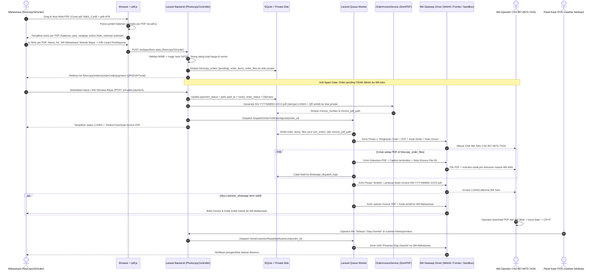
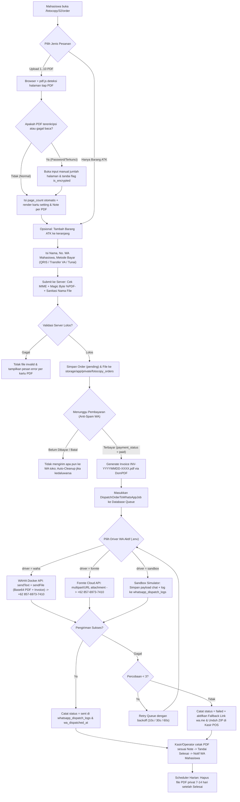
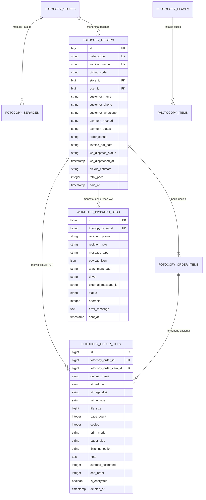

# Blueprint & Master Tracking: Alur Pemesanan Multi-PDF, Auto Page Count, Invoice PDF & Auto-Send WhatsApp Fotokopi Kampus (`USUClassMap`)

> **Status Dokumen:** Fase Audit, Analisis Multi-POV, Desain Arsitektur, Penyiapan Data Trial, & **Implementasi Sprint A–F SELESAI 100%** (`[x]`).  
> **Target Proyek:** `USUClassMap` (`D:\Documents\TUBES WEB SEMANTIK\Kelompok 3 Web Semantik\USUClassMap`)  
> **Mitra Uji Coba Resmi:** **`Fotocopy Trial Admin`** — WhatsApp `+62 857-6973-7410` (`6285769737410`)  
> **Tanggal Pembuatan:** 24 November 2026

---

## Daftar Isi

1. [Bab 1: Ringkasan Audit Sistem Pemesanan & Upload Saat Ini](#bab-1-ringkasan-audit-sistem-pemesanan--upload-saat-ini)
2. [Bab 2: Analisis Mendalam Alur Fotokopi Kampus (4 POV) & Diagram Alur](#bab-2-analisis-mendalam-alur-fotokopi-kampus-4-pov--diagram-alur)
3. [Bab 3: Spesifikasi UX Upload Multi-PDF, Auto Page Count & Note per File PDF](#bab-3-spesifikasi-ux-upload-multi-pdf-auto-page-count--note-per-file-pdf)
4. [Bab 4: Desain Skema Database & Model Relasi Baru](#bab-4-desain-skema-database--model-relasi-baru)
5. [Bab 5: Arsitektur WhatsApp Auto-Dispatch & Generator Invoice PDF](#bab-5-arsitektur-whatsapp-auto-dispatch--generator-invoice-pdf)
6. [Bab 6: Dokumentasi & Verifikasi Toko `Fotocopy Trial Admin`](#bab-6-dokumentasi--verifikasi-toko-fotocopy-trial-admin)
7. [Bab 7: Master Tracking Checklist Implementasi Bertahap (Sprint A–F)](#bab-7-master-tracking-checklist-implementasi-bertahap-sprint-af)

---

## Bab 1: Ringkasan Audit Sistem Pemesanan & Upload Saat Ini

Audit dilakukan secara *read-only* terhadap seluruh kode backend, model, migrasi, view Blade/Alpine.js, paket Composer, konfigurasi queue/filesystem, dan isi SQLite (`database/database.sqlite`) per 24 November 2026.

### 1.1 Inventaris Komponen Pemesanan, Pembayaran, Upload & WhatsApp Eksisting

| Lapisan | File / Artefak | Kondisi Terverifikasi Saat Ini |
| :--- | :--- | :--- |
| **Route Publik** | `USUClassMap/routes/web.php` (baris 36–49) | `GET /fotocopy`, `GET /fotocopy/{id}`, `GET /fotocopy/{id}/order`, `POST /fotocopy/{id}/order`, `GET /fotocopy/orders/{orderCode}/payment`, `POST /fotocopy/orders/{orderCode}/simulate-payment` (beserta alias `/photocopy-directory/*`). |
| **Route Panel Toko** | `USUClassMap/routes/web.php` (baris 131–157) | `/admin-fotokopi/*` (`dashboard`, `stores`, `services`, `reports`) dilindungi `['auth', 'admin.fotokopi']`; `/cashier-fotokopi/*` (`orders`, `orders/{order}/status`, `orders/{order}/file`, `orders/{order}/print`, `pos`) dilindungi `['auth', 'cashier.fotokopi']`. |
| **CSRF Exception** | `USUClassMap/bootstrap/app.php` (baris 15–18) | Pengecualian CSRF aktif pada `fotocopy/orders/*/simulate-payment` dan `photocopy-directory/orders/*/simulate-payment`. |
| **Controller Publik** | `USUClassMap/app/Http/Controllers/PhotocopyController.php` (baris 15–329) | `storeOrder()` (L162–286) hanya menerima payload JSON item + `notes` global; `simulatePayment()` (L309–328) hanya memanggil `PaymentManager::simulateSuccess($order)` tanpa memicu generasi Invoice PDF atau pengiriman WhatsApp. |
| **Controller Kasir POS** | `USUClassMap/app/Http/Controllers/CashierFotokopi/OrderController.php` (baris 14–218) | `storePos()` (L118–195) hanya mendukung 1 file (`'file' => 'nullable|file|max:25600'`) disimpan ke `Storage::disk('public')` folder `fotocopy_docs`; `updateStatus()` (L74–93) mengubah status tanpa mengirim notifikasi ke mahasiswa. |
| **Controller Admin Toko** | `USUClassMap/app/Http/Controllers/AdminFotokopi/StoreController.php` (baris 12–164) | `store()`/`update()` menerima input `whatsapp` pada `fotocopy_stores`, lalu `syncToPhotocopyPlace()` (L17–61) melakukan sinkronisasi ke `photocopy_places`. |
| **Engine Pembayaran** | `USUClassMap/app/Services/Payment/PaymentManager.php`, `QrisPaymentStrategy.php`, `BankTransferPaymentStrategy.php`, `CashPaymentStrategy.php`, `config/payment.php` | Mendukung 3 strategi (`qris` EMVCo SVG, `bank_transfer` VA statis PoC `88019920260001`, dan `cash` kasir). Ketiganya mengubah `payment_status = 'paid'` & `paid_at = now()` saat `simulateSuccess()`. |
| **Model Order & Toko** | `FotocopyOrder.php`, `FotocopyOrderItem.php`, `FotocopyStore.php`, `PhotocopyPlace.php` | `FotocopyOrder` menyimpan metadata file tunggal (`file_path`, `file_name`, `file_size`, `file_type`) langsung di tabel `fotocopy_orders`. Relasi multi-file dan log WA belum ada. |
| **Skema DB Order** | `2026_11_13_000002_create_fotocopy_tables.php`, `2026_11_14_040808_add_file_attachment_to_fotocopy_orders_table.php`, `2026_11_14_060000_add_payment_details_to_fotocopy_orders_table.php` | `fotocopy_orders` berisi 20 kolom; `fotocopy_order_items` berisi 9 kolom (`order_id`, `service_id`, `service_name`, `category`, `price`, `quantity`, `subtotal`, timestamps). |
| **View Checkout & Bayar** | `resources/views/features/fotocopy/public/order.blade.php` (450 baris) & `payment.blade.php` (539 baris) | `order.blade.php` mengirim pure JSON (`Content-Type: application/json`) dari Alpine `cart`; `payment.blade.php` menampilkan QRIS SVG/VA/Tunai, tombol simulasi PoC, tombol cetak `window.print()`, dan link manual `wa.me`. |
| **View Kasir & SPK** | `resources/views/features/fotocopy/cashier/orders/index.blade.php` (453 baris), `pos.blade.php` (305 baris), `print.blade.php` (413 baris) | Antrean kasir hanya merender max 1 banner lampiran file + modal iframe preview + tombol `window.print()`. POS walk-in hanya punya 1 dropzone file tunggal. |
| **Composer & Infra** | `composer.json`, `.env`, `config/filesystems.php` | Belum ada paket PDF generator (`barryvdh/laravel-dompdf` tidak terpasang). `.env` sudah memakai `QUEUE_CONNECTION=database` (tabel `jobs` tersedia) dan `FILESYSTEM_DISK=local` (`storage/app/private`). |
| **Data Storage Aktual** | `storage/app/public/fotocopy_docs/` & 5 baris `fotocopy_orders` | Folder `fotocopy_docs/` **kosong** (belum terbentuk). Order seed `#1` & `#2` mereferensikan `fotocopy_docs/sample_*.pdf` yang file fisiknya tidak ada; order publik terbaru `#5` & `#6` memiliki `customer_phone = NULL` dan `file_path = NULL`. |

---

### 1.2 Daftar Celah (Gap) Fungsional & Bug Eksisting Terverifikasi

| No | Kategori | Temuan Spesifik & Lokasi Kode | Dampak / Risiko Nyata | Target Penyelesaian |
| :--- | :--- | :--- | :--- | :--- |
| **1** | **Gap Fitur Utama** | **Checkout publik (`/fotocopy/{id}/order`) belum memiliki upload PDF sama sekali.** `order.blade.php` (L100–115) mengirim JSON mentah dan `PhotocopyController::storeOrder()` (L172–185) tidak memvalidasi `$request->file(...)`. | Mahasiswa harus mencari manual nomor WA toko dan mengirim file secara terpisah; sering terjadi file tidak cocok dengan kode order. | **Sprint B** |
| **2** | **Gap Fitur Utama** | **POS Kasir (`/cashier-fotokopi/pos`) hanya mendukung 1 file.** `OrderController::storePos()` (L127) memvalidasi single `'file'`, dan `fotocopy_orders` hanya menyediakan kolom skalar tunggal `file_path`, `file_name`, `file_size`, `file_type`. | Tidak bisa menangani skenario mahasiswa mencetak >1 PDF dalam 1 order (mis. `Cover.pdf` + `Bab1_5.pdf` + `Lampiran.pdf`). | **Sprint A & B** |
| **3** | **Gap Fitur Utama** | **Tidak ada auto-deteksi jumlah halaman PDF dan tidak ada kolom Note per PDF.** `order.blade.php` (L340–348) hanya punya 1 textarea `orderNotes` global. | Mahasiswa salah menghitung qty lembar cetak; operator bingung file mana yang harus cetak warna/bolak-balik/jilid tertentu. | **Sprint B** |
| **4** | **Gap Privasi & Keamanan** | **Lampiran POS disimpan di disk `public`.** `OrderController::storePos()` (L150) memanggil `$uploaded->store('fotocopy_docs', 'public')` dan `FotocopyOrder::fileUrl()` (L111) memakai `asset('storage/...')`. | File skripsi, KTP, atau transkrip nilai mahasiswa dapat diakses langsung tanpa autentikasi oleh siapa pun yang menebak/menemukan URL. | **Sprint A & F** |
| **5** | **Gap Invoice PDF** | **Belum ada generator file Invoice PDF resmi.** `composer.json` tidak memuat `barryvdh/laravel-dompdf`; `payment.blade.php:515` & `print.blade.php:407` hanya memanggil `window.print()`. | Sistem tidak memiliki file `INV-YYYYMMDD-XXXX.pdf` untuk diunduh mahasiswa atau dilampirkan otomatis ke WhatsApp toko saat `paid`. | **Sprint C** |
| **6** | **Gap Automasi WA** | **Integrasi WhatsApp hanya berupa link statis `https://wa.me/...?text=...`** (`PhotocopyController.php:268`, `payment.blade.php:500`), tanpa dispatch queue dan tanpa log pengiriman. | Protokol `wa.me` **tidak mendukung pengiriman lampiran file PDF/Invoice otomatis**, dan pesan tidak terkirim otomatis ketika status pembayaran berubah `paid`. | **Sprint D & E** |
| **7** | **Gap UI Checkout** | **Field `customerPhone` tersembunyi di `order.blade.php`.** Variabel Alpine `customerPhone` dideklarasikan di L15 & dikirim di L109, tetapi tidak ada `<input>` HTML-nya di formulir. | Seluruh pesanan publik (`#5`, `#6`) tercatat dengan `customer_phone = NULL`, sehingga kasir tidak bisa menghubungi mahasiswa bila file bermasalah/selesai. | **Sprint B** |
| **8** | **Bug Eksisting** | **`AdminFotokopi\StoreController::syncToPhotocopyPlace()` (L24, L55, L153) & `FotocopyOrder::photocopyPlace()` (L154) masih mencocokkan lewat `id` mentah, bukan `slug`.** Padahal ID antar tabel sudah bergeser (contoh: `fotocopy_stores` max ID 33 vs `photocopy_places` max ID 32). | Berisiko menyinkronkan atau menampilkan nama/nomor WA toko yang salah pada halaman pembayaran/relasi model. | **Sprint A** |
| **9** | **Bug Eksisting** | **`CashPaymentStrategy.php` (L21–23), `PhotocopyController.php` (L299), & `payment.blade.php` (L331) mengakses properti yang tidak ada.** Kolom `photocopy_place_id` tidak ada di `fotocopy_orders` (`store_id`), dan kolom `address` tidak ada di `PhotocopyPlace`/`FotocopyStore` (`location_name`). | Alamat toko kosong pada instruksi pembayaran Tunai dan payload JSON `cash`. | **Sprint A** |
| **10** | **Bug Eksisting** | **Inkonsistensi format tampilan & normalisasi WhatsApp.** `show.blade.php:168` menulis `+{{ $place->whatsapp }}` (jika tersimpan dengan `+` akan tampil `++62...`); `cashier/orders/index.blade.php:100` hanya menghapus non-digit tanpa mengubah awalan `08...` -> `628...`. | Link WA kasir ke nomor mahasiswa `0812...` gagal dibuka di `wa.me`; potensi tampilan `++` jika input admin tidak dinormalisasi menjadi format digit `628...`. | **Sprint A** |

---

## Bab 2: Analisis Mendalam Alur Fotokopi Kampus (4 POV) & Diagram Alur

Desain sistem disusun berdasarkan observasi operasional nyata kios fotokopi di sekitar Kampus USU agar proses pemesanan mahasiswa lebih cepat daripada chat manual, sementara operator mesin cetak tetap dapat bekerja langsung dari **WhatsApp Web** yang selalu terbuka di komputer kasir.

### 2.1 Analisis 4 Sudut Pandang (POV)

#### POV 1: Mahasiswa / User Publik (Pemesan)
- **Skenario Nyata:** Menjelang jam kuliah atau bimbingan, mahasiswa biasanya mencetak lebih dari satu PDF sekaligus dengan perlakuan berbeda, ditambah membeli ATK:
  - `Cover_Skripsi.pdf` (1 hal) → Print Warna Kertas Glossy 230gr, 1 rangkap, catatan: *"Jadikan sampul depan, sisakan margin kiri 4cm"*.
  - `Bab1_5_Skripsi.pdf` (84 hal) → Print Hitam Putih A4 80gr, 2 rangkap + Jilid Lakban Hitam Mika Bening, catatan: *"Halaman 12 & 47 tolong cetak warna, sisanya hitam putih"*.
  - Barang ATK → `2x Pulpen Snowman V5 Hitam` + `1x Map Snellhecter Plastik Biru`.
- **Kebutuhan UX Utama:**
  1. **Drag & Drop Multi-PDF** hingga 10 file sekaligus dengan progress bar dan validasi instan tipe `.pdf` serta ukuran (`<= 25 MB/file`).
  2. **Auto-Detect Jumlah Halaman (`pdf.js` di browser + verifikasi parser backend):** Jumlah halaman langsung muncul pada kartu PDF dan otomatis dikalikan dengan jumlah rangkap serta tarif jasa (`halaman × rangkap × tarif_satuan`), sehingga mahasiswa melihat transparansi harga sebelum bayar.
  3. **Pengaturan & Note Khusus per File PDF:** Setiap PDF menjadi 1 kartu konfigurasi mandiri (pilih mode cetak/jasa, jumlah rangkap, finishing/jilid opsional, dan textarea **Note Khusus File Ini**) — bukan disatukan ke 1 kotak catatan umum.
  4. **Keranjang Campuran Fleksibel:** Checkout tetap menerima 3 skenario: *(a) Jasa cetak PDF saja*, *(b) Barang ATK saja (tanpa upload file)*, maupun *(c) Campuran Multi-PDF + Barang ATK* dalam 1 pembayaran.
  5. **Input No. WhatsApp Mahasiswa & Kepastian Pengambilan:** Mahasiswa mengisi No. WA (`08...` / `+62...`) untuk menerima salinan Invoice PDF + notifikasi otomatis saat cetakan **Siap Diambil**, serta langsung memperoleh halaman status pembayaran, tombol unduh **Bukti Invoice PDF (`INV-...`)**, dan **Kode Ambil**.

#### POV 2: Operator / Pegawai Fotokopi (Pengguna Harian WhatsApp Web)
- **Realita Lapangan:** Komputer operator mesin fotokopi/printer hampir selalu menyalakan **WhatsApp Web / WA Desktop**, bukan tab dashboard admin baru per pelanggan. Membuka dashboard hanya untuk mengklik 5 tombol per order memperlambat antrean counter saat jam sibuk.
- **Mekanisme Ideal Saat Pembayaran Lunas (`paid`):**
  1. **Kebijakan Anti-Spam Unpaid:** Order berstatus `payment_status = 'pending'` (QRIS/VA belum dibayar atau pesanan batal sebelum bayar) **TIDAK BOLEH** dikirim ke WhatsApp toko. Antrean WA operator dijamin 100% berisi pesanan sah yang siap diproduksi (pengecualian opsional: pesanan Tunai/COD hanya jika toko mengaktifkan mode terima pesanan bayar-di-tempat, namun default sistem disarankan **trigger setelah `paid`** agar zero order fiktif).
  2. **Paket Pesan Berurutan Otomatis Saat Status Menjadi `paid`:**
     - **Pesan 1 (Ringkasan Order & SPK Teks):** Memuat Kode Order (`#ORD-...`), Kode Ambil (`AMB-...`), Nomor Invoice (`INV-...`), Nama & No. WA Mahasiswa, Status **LUNAS** + metode bayar, estimasi siap ambil, daftar barang ATK yang harus disiapkan dari rak, serta daftar indeks seluruh file PDF.
     - **Pesan 2..N (Seluruh Lampiran File PDF Satu per Satu):** Setiap file PDF dikirim langsung sebagai dokumen attachment WA lengkap dengan **caption terstruktur** berisi urutan `[File i/N]`, nama file asli, jumlah halaman & rangkap, pilihan layanan/kertas/jilid, dan **CATATAN KHUSUS USER (Note per PDF)** yang dicetak tebal agar langsung terbaca operator sebelum menekan Download → `Ctrl+P`.
     - **Pesan Terakhir (Bukti Invoice Resmi PDF):** File `INV-YYYYMMDD-XXXX.pdf` berstempel **LUNAS** dikirim sebagai arsip digital antara toko dan pelanggan.
  3. **Apakah Mahasiswa Sebaiknya Juga Menerima Pesan WA Otomatis?** **YA (Dual-Side Notification, Opt-In):**
     - Saat pembayaran sukses (`paid`): kirim 1 pesan konfirmasi + lampiran `INV-YYYYMMDD-XXXX.pdf` ke WA mahasiswa (jika mengisi nomor WA valid) berisi Kode Ambil dan estimasi waktu selesai.
     - Saat kasir/operator menekan tombol **"Selesai / Siap Diambil"** di dashboard kasir: kirim 1 pesan singkat ke WA mahasiswa agar mahasiswa segera datang mengambil berkas, mengurangi penumpukan pelanggan yang bolak-balik bertanya di meja kasir.

#### POV 3: Kasir POS & Pemilik Toko (Admin Fotokopi)
- **Sinkronisasi Penuh dengan WA:** Setiap order web (berkas PDF + note + status pengiriman WA) otomatis muncul real-time di `/cashier-fotokopi/orders` berdampingan dengan transaksi walk-in dari `/cashier-fotokopi/pos`.
- **Kontrol Operasional yang Dibutuhkan:**
  - Kolom/Badge status dispatch WA per order: `Menunggu Bayar` / `Queued` / `Terkirim (3/3 File + Invoice)` / `Sebagian Gagal` / `Mode Sandbox`.
  - Tombol **"Kirim Ulang ke WA"** jika koneksi internet toko sempat putus saat webhook bayar masuk.
  - Daftar file PDF multi-baris pada tabel order lengkap dengan badge jumlah halaman, note per file yang disorot kuning, tombol **Preview** per file, **Unduh Satuan**, dan **Unduh Semua PDF (`.zip`)** sebagai cadangan jika WA Web operator sedang bermasalah.
  - Di `/admin-fotokopi/stores`: form input nomor WhatsApp aktif toko dengan validasi + normalisasi otomatis ke `628...` dan tombol **"Tes Kirim Pesan ke WA Toko"** agar pemilik yakin nomor seperti `+62 857-6973-7410` terhubung sebelum membuka toko.

#### POV 4: Super Admin, Keamanan Privasi & Edge Cases
- **Privasi Dokumen Mahasiswa:** File skripsi, ijazah, KTP, dan berkas kuliah tidak boleh berada di disk `public`. File disimpan pada `storage/app/private/fotocopy_orders/{order_code}/` (disk `local`), diakses hanya melalui route terproteksi middleware role atau **Signed URL** dengan masa berlaku terbatas (`URL::temporarySignedRoute(..., now()->addMinutes(30))`).
- **Validasi File Ketat:** Selain cek ekstensi `.pdf`, lakukan pemeriksaan MIME asli dan **magic byte `%PDF-`** pada 5 byte awal file untuk menolak skrip berbahaya yang diganti ekstensi menjadi `.pdf`, serta sanitasi nama file (`Str::slug`) sebelum disimpan di disk (nama asli tetap disimpan di kolom `original_name`).
- **Auto-Cleanup Terjadwal:** Command Artisan `fotocopy:cleanup-files` (dijalankan harian via scheduler Laravel) menghapus file PDF order setelah 7–14 hari berstatus `Selesai` atau `Dibatalkan` untuk menjaga kapasitas disk server dan privasi dokumen sensitif, sementara catatan transaksi, invoice, dan metadata log tetap tersimpan untuk laporan keuangan.
- **Penanganan Edge Cases Wajib:**
  - **PDF Terproteksi Password (*Encrypted*):** `pdf.js` mendeteksi `PasswordException` → UI tetap mengizinkan upload dengan badge *"PDF Terkunci Password"*, membuka input manual jumlah halaman, dan memberi tanda pengingat di caption WA (mahasiswa diminta menuliskan password di kolom Note atau membuka kunci PDF terlebih dahulu).
  - **PDF Korup / Halaman 0:** Tolak saat upload jika struktur header tidak valid `%PDF-` atau gagal dirender `pdf.js` agar operator tidak menerima file rusak setelah dibayar.
  - **File > 25 MB (Batas Kirim Dokumen WhatsApp Gateway Tertentu):** Jika file PDF antara 16–25 MB melewati batas gateway tertentu (mis. batasan paket Cloud API), driver otomatis menyisipkan link download bertanda tangan 24 jam + instruksi alternatif di pesan WA tanpa menggagalkan pengiriman file lain maupun Invoice.
  - **Gateway WA Offline / Timeout:** Seluruh pengiriman WA berjalan asinkron via `DispatchOrderToWhatsAppJob` (`QUEUE_CONNECTION=database`, 3x retry dengan backoff 10s, 30s, 60s). Jika seluruh retry gagal, status menjadi `failed`, pesan error tercatat di `whatsapp_dispatch_logs`, sistem jatuh ke Smart `wa.me` Fallback + daftar download ZIP di Kasir POS agar order tetap bisa dicetak tanpa kehilangan transaksi.

---

### 2.2 Diagram Sequence End-to-End (Multi-PDF → Bayar → Auto-Kirim WA Toko & Mahasiswa)



---

### 2.3 Diagram Flowchart Alur Keputusan & Penanganan Kegagalan



---

## Bab 3: Spesifikasi UX Upload Multi-PDF, Auto Page Count & Note per File PDF

### 3.1 Wireframe Antarmuka Halaman Pemesanan (`/fotocopy/{id}/order`)

Layout menggunakan struktur grid 2 kolom eksisting (`order.blade.php` — kiri 2 kolom katalog/upload, kanan 1 kolom ringkasan keranjang & bayar), namun di atas daftar katalog ditambahkan **Panel Upload Dokumen Cetak (Multi-PDF)** yang terhubung langsung ke ringkasan keranjang di sebelah kanan:

```text
+---------------------------------------------------------------------------------------------------+
| HEADER TOKO: Fotocopy Trial Admin [BUKA 07:30 - 22:00] | Depan Fasilkom-TI | WhatsApp +62 857-... |
+---------------------------------------------------------------------------------------------------+
| KOLOM KIRI (lg:col-span-2)                                | KOLOM KANAN - STICKY (lg:col-span-1) |
|                                                           |                                      |
| [1] UPLOAD DOKUMEN PDF UNTUK DICETAK (MULTI-FILE)         | KERANJANG PESANAN           [3 Item] |
| +-------------------------------------------------------+ | ------------------------------------ |
| |  [Ikon PDF] Tarik & lepas beberapa file PDF di sini   | | DOKUMEN CETAK (2 File PDF)           |
| |  atau Klik untuk memilih file (Maks 10 PDF, 25MB/file)| | 1. Cover_Skripsi.pdf                 |
| |  Auto-deteksi jumlah halaman & hitung biaya otomatis  | |    1 hal x 1x • Print Warna Glossy   |
| +-------------------------------------------------------+ |    Note: "Jadikan cover depan..."    |
|                                                           |    Subtotal: Rp 4.000                |
| KARTU FILE #1 — Cover_Skripsi.pdf               [Hapus]   | 2. Bab1_5_Skripsi.pdf                |
| +-------------------------------------------------------+ |    84 hal x 2x • B&W + Lakban Mika   |
| | [PDF] 1 Halaman (Terdeteksi Otomatis pdf.js) | 412 KB | |    Note: "Hal 12 & 47 warna..."      |
| |                                                       | |    Subtotal: Rp 49.000             |
| | Layanan Cetak : [Print Warna Glossy 230gr (Rp 4.000)] | | ------------------------------------ |
| | Finishing/Jilid: [Tanpa Jilid / Lepas (Rp 0)]         | | BARANG ATK (Dari Katalog)            |
| | Jumlah Rangkap : [-]  1  [+]                          | | - Pulpen Snowman V5 (x2)   Rp 7.000  |
| | Estimasi Biaya : Rp 4.000 (1 hal x 1 rangkap x 4.000) | | - Map Snellhecter (x1)     Rp 4.500  |
| |                                                       | | ------------------------------------ |
| | *Catatan Khusus File Ini (Dikirim ke WA Operator):*   | | DATA PEMESAN                         |
| | [Textarea: "Jadikan sampul depan, sisakan margin 4cm"]| | Nama Pemesan* : [Daffa Saragih     ] |
| +-------------------------------------------------------+ | No. WhatsApp* : [085270001122      ] |
|                                                           |   (Untuk kirim Invoice & Info Siap)  |
| KARTU FILE #2 — Bab1_5_Skripsi.pdf              [Hapus]   | Catatan Umum  : [Ambil jam 13.00 WIB]|
| +-------------------------------------------------------+ | ------------------------------------ |
| | [PDF] 84 Halaman (Terdeteksi Otomatis pdf.js) | 3.8 MB| | METODE BAYAR: [QRIS] [VA] [Tunai]    |
| | Layanan Cetak : [Print H/P A4 80gr (Rp 300/lbr)]      | |                                      |
| | Finishing/Jilid: [Jilid Lakban Mika Hitam (Rp 4.500)] | | TOTAL TAGIHAN:            Rp 64.500  |
| | Jumlah Rangkap : [-]  2  [+]                          | |                                      |
| | Estimasi Biaya : Rp 59.400                            | | [Lanjut ke Pembayaran ->]     [Maps] |
| | *Catatan Khusus File Ini:*                            | +------------------------------------+
| | [Textarea: "Hal 12 & 47 warna, bolak-balik mulai B2"] |
| +-------------------------------------------------------+
|                                                           |
| [2] TAMBAH BARANG ATK / JASA TAMBAHAN DARI KATALOG TOKO   |
| (Filter Kategori, Merek, Segment & Grid Kartu 102 Item)   |
+---------------------------------------------------------------------------------------------------+
```

#### Rumus Kalkulasi Transparan per Kartu PDF
- **Biaya Cetak per Rangkap:** `page_count × tarif_layanan_cetak` *(jika dipilih opsi bolak-balik/duplex di metadata atau layanan khusus, tarif mengikuti item jasa bolak-balik toko tersebut).*
- **Biaya Finishing per Rangkap:** `tarif_jilid_atau_laminating` (`0` jika tanpa finishing).
- **Subtotal per File PDF:** `copies × ((page_count × tarif_layanan_cetak) + tarif_finishing)`.
- *Catatan Keamanan Perhitungan:* Estimasi di JavaScript hanya untuk pratinjau UX instan; saat `POST /fotocopy/{id}/order`, backend **wajib menghitung ulang seluruh subtotal** berdasarkan harga asli di database (`fotocopy_services` / `photocopy_items`) dan `page_count` terverifikasi server agar harga tidak bisa dimanipulasi dari DevTools browser.

---

### 3.2 Contoh Format Pesan & Caption WhatsApp Otomatis ke `+62 857-6973-7410`

Setelah mahasiswa melunasi tagihan (`payment_status = 'paid'`), `DispatchOrderToWhatsAppJob` mengirimkan **paket berurutan** ke nomor WhatsApp toko **`6285769737410` (`+62 857-6973-7410`)** dengan jeda 1–2 detik per pesan agar urutan pesan di WhatsApp Web operator rapi dan tidak memicu *rate-limit*:

#### Pesan 1 — Ringkasan Order & SPK Cepat (Teks)
```text
*ORDER CETAK BARU — SUDAH LUNAS*
Toko Tujuan : Fotocopy Trial Admin
Kode Order  : #ORD-20261124-A7K9
No. Invoice : INV-20261124-0042
Kode Ambil  : *AMB-492*
Waktu Bayar : 24 Nov 2026, 09:15 WIB
Status Bayar: *LUNAS* (QRIS Dinamis)

*Data Pemesan:*
• Nama  : Daffa Umayans Saragih (NIM 251402011)
• No WA : +62 852-7000-1122
• Est. Selesai : +/- 25 menit (siap ~09:40 WIB)

*Daftar Dokumen PDF (2 File):*
1. `Cover_Skripsi.pdf` (1 hal × 1x | Print Warna Glossy)
2. `Bab1_5_Skripsi.pdf` (84 hal × 2x | Print H/P A4 80gr + Jilid Lakban Mika)

*Tambahan Barang ATK:*
• Pulpen Snowman V5 Hitam (x2) — Rp 7.000
• Map Snellhecter Plastik Biru (x1) — Rp 4.500

*Catatan Umum Pelanggan:*
"Tolong disiapkan sebelum jam 13.00 WIB, saya ambil selesai kelas."

*TOTAL DIBAYAR: Rp 70.900*
_File PDF beserta instruksi cetak spesifik dikirim tepat di pesan-pesan berikutnya._
```

#### Pesan 2 — Lampiran File PDF 1/2 (Document Attachment + Caption + Note Khusus)
*(Terkirim sebagai file dokumen `Cover_Skripsi.pdf`)*
```text
*[File 1/2] Cover_Skripsi.pdf*
Order : #ORD-20261124-A7K9 | Ambil: *AMB-492*
Pemesan : Daffa Umayans Saragih
Spec Cetak:
• Jumlah Halaman : 1 halaman
• Jumlah Rangkap : 1 rangkap
• Layanan Cetak  : Print Warna Glossy 230gr (A4)
• Finishing      : Tanpa Jilid

*CATATAN KHUSUS FILE INI:*
"Jadikan sampul depan, sisakan margin kiri 4cm, jangan dipotong garis pinggir."
```

#### Pesan 3 — Lampiran File PDF 2/2 (Document Attachment + Caption + Note Khusus)
*(Terkirim sebagai file dokumen `Bab1_5_Skripsi.pdf`)*
```text
*[File 2/2] Bab1_5_Skripsi.pdf*
Order : #ORD-20261124-A7K9 | Ambil: *AMB-492*
Pemesan : Daffa Umayans Saragih
Spec Cetak:
• Jumlah Halaman : 84 halaman (Total cetak: 168 sisi/lembar)
• Jumlah Rangkap : 2 rangkap
• Layanan Cetak  : Print Hitam Putih A4 HVS 80gsm
• Finishing      : Jilid Lakban Hitam + Mika Bening

*CATATAN KHUSUS FILE INI:*
"Halaman 12 & 47 tolong cetak BERWARNA, sisanya hitam putih saja. Pastikan halaman daftar isi rapi sebelum dijilid."
```

#### Pesan 4 — Lampiran Bukti Invoice Resmi (Document Attachment)
*(Terkirim sebagai file PDF `INV-20261124-0042.pdf`)*
```text
*BUKTI INVOICE RESMI (LUNAS)*
No. Invoice : INV-20261124-0042
Kode Order  : #ORD-20261124-A7K9
Pemesan     : Daffa Umayans Saragih
Total Lunas : Rp 70.900 (QRIS)
Lampiran ini adalah arsip bukti pembayaran resmi dari USUClassMap.
```

#### Pesan Opsional ke WhatsApp Mahasiswa (Dua Tahap)
- **Tahap Bayar Sukses:** Dikirim ke `customer_whatsapp` mahasiswa dengan lampiran `INV-20261124-0042.pdf` berisi ringkasan tagihan lunas, lokasi toko `Fotocopy Trial Admin`, dan Kode Ambil **`AMB-492`**.
- **Tahap Selesai Cetak (saat kasir klik `Selesai`):**
  ```text
  Halo Daffa Umayans Saragih,
  Pesanan Anda *#ORD-20261124-A7K9* di *Fotocopy Trial Admin* sudah *SELESAI DICETAK & SIAP DIAMBIL*.
  Tunjukkan Kode Ambil: *AMB-492* kepada staf kasir.
  Lokasi: Depan Gedung Fasilkom-TI USU, Jl. Universitas No. 9A.
  ```

---

### 3.3 Aturan Validasi, Batasan Teknis & Kebijakan Privasi Dokumen

| Parameter | Nilai Kebijakan / Implementasi | Alasan Teknis & Keamanan |
| :--- | :--- | :--- |
| **Format File Publik** | Wajib `.pdf` (`application/pdf`, `mimetypes:application/pdf`) | Menjamin hasil cetak tidak bergeser layout seperti `.docx` dan mendukung deteksi jumlah halaman akurat via `pdf.js`. *(POS kasir tetap mendukung `.docx/.jpg/.png` untuk walk-in flashdisk).* |
| **Validasi Magic Byte** | Cek 5 byte awal file === `%PDF-` | Mencegah pengunggahan file PHP/JS/EXE yang diubah ekstensinya menjadi `.pdf`. |
| **Batas Ukuran per File** | Maksimal `25 MB` per file PDF (`max:25600` KB) | Selaras dengan batas upload POS eksisting dan aman untuk pengiriman WhatsApp HTTP API (WAHA). |
| **Batas File & Total Upload** | Maksimal `10 file` per transaksi, total maksimal `80 MB` per order | Mencegah kelelahan memori server PHP dan batas timeout HTTP saat upload paralel/checkout. |
| **Batas Karakter Note per PDF** | Opsional, maksimal `500 karakter` per file | Cukup ekspresif untuk instruksi halaman/kertas spesifik namun tetap muat rapi dalam caption WhatsApp (`max 1024` char). |
| **PDF Terenkripsi / Password** | Flag `is_encrypted = true` + fallback input `page_count` manual (min `1`) | Tidak memblokir mahasiswa yang PDF-nya hanya terproteksi *edit restriction*, sekaligus memberi peringatan ke operator lewat caption WA. |
| **Lokasi Penyimpanan** | Disk `local` (`storage/app/private/fotocopy_orders/{Y}/{m}/{order_code}/`) | File terisolasi dari folder `public/storage`, tidak dapat diakses via URL statis tanpa otorisasi. |
| **Akses Unduh File** | Controller endpoint terproteksi role Kasir/Admin ATAU Signed URL (`30 menit`) | Melindungi privasi dokumen skripsi, identitas, dan berkas akademik milik mahasiswa. |
| **Retensi & Auto-Cleanup** | Hapus fisik PDF otomatis `14 hari` setelah `Selesai`/`Dibatalkan` (atau order `pending` > `48 jam`) via `php artisan fotocopy:cleanup-files` | Menghindari pembengkakan storage VPS dan memenuhi prinsip minimisasi data sensitif. Catatan DB order & nomor invoice tetap dipertahankan. |

---

## Bab 4: Desain Skema Database & Model Relasi Baru

### 4.1 Entity-Relationship Diagram (ERD) Skema Target



---

### 4.2 Spesifikasi Kolom Migrasi Baru & Perubahan Tabel Eksisting

#### A. Penambahan Kolom pada Tabel `fotocopy_orders`
*Kompatibilitas Mundur:* Kolom lama `file_path`, `file_name`, `file_size`, `file_type` dipertahankan nullable agar data seed & transaksi kasir lama tetap terbaca normal tanpa regresi.

| Kolom Baru | Tipe & Panjang | Nullable / Default | Keterangan Fungsional |
| :--- | :--- | :--- | :--- |
| `customer_whatsapp` | `string(30)` | Nullable | Nomor WA ternormalisasi `628...` milik mahasiswa untuk menerima salinan invoice & notif `Siap Diambil`. |
| `invoice_number` | `string(40)` `unique` | Nullable | Nomor invoice resmi dengan format `INV-YYYYMMDD-XXXX` (dibuat otomatis saat `payment_status = 'paid'`). |
| `invoice_pdf_path` | `string(255)` | Nullable | Path relatif file PDF invoice di disk `local` (`invoices/2026/11/INV-....pdf`). |
| `pickup_code` | `string(16)` `index` | Nullable | Kode ambil pendek yang mudah disebut di kasir (mis. `AMB-492`). |
| `pickup_estimate` | `string(100)` | Nullable | Estimasi waktu selesai cetak yang dihitung dari total halaman order + antrean toko. |
| `wa_dispatch_status` | `string(20)` | Default `'not_ready'` | Enum status agregat: `not_ready`, `queued`, `partial`, `sent`, `failed`, `sandbox`. |
| `wa_dispatched_at` | `timestamp` | Nullable | Timestamp penyelesaian pengiriman seluruh paket pesan + PDF + Invoice ke WA toko. |

#### B. Tabel Baru: `fotocopy_order_files`

| Kolom | Tipe & Constraint | Keterangan |
| :--- | :--- | :--- |
| `id` | `bigIncrements` PK | Primary key file dokumen. |
| `fotocopy_order_id` | `foreignId` -> `fotocopy_orders.id` (`cascadeOnDelete`, `index`) | Relasi ke order induk. |
| `fotocopy_order_item_id` | `foreignId` -> `fotocopy_order_items.id` (`nullOnDelete`) | Opsional mengikat baris item jasa cetak di tabel nota. |
| `original_name` | `string(255)` | Nama file asli dari mahasiswa (mis. `Bab1_5_Skripsi.pdf`) untuk tampilan & nama file saat dikirim ke WA. |
| `stored_path` | `string(500)` | Path aman ter-slug di disk privat (`fotocopy_orders/2026/11/ORD-.../01-bab1-5-skripsi.pdf`). |
| `storage_disk` | `string(30)` default `'local'` | Disk Laravel (`local` = `storage/app/private`). |
| `mime_type` | `string(100)` | MIME terverifikasi server (`application/pdf`). |
| `file_size` | `unsignedBigInteger` | Ukuran dalam byte agar mudah diformat (`MB`/`KB`) dan dicek batas 25 MB. |
| `page_count` | `unsignedInteger` default `1` | Jumlah halaman hasil deteksi `pdf.js` + verifikasi parser backend. |
| `copies` | `unsignedInteger` default `1` | Jumlah rangkap cetak yang diminta mahasiswa untuk dokumen ini. |
| `print_mode` | `string(100)` | Nama/kode mode cetak terpilih (mis. `Print Hitam Putih A4 HVS 80gsm`, `Print Warna Glossy`). |
| `paper_size` | `string(30)` default `'A4'` | Ukuran kertas (`A4`, `F4`, `A3`, `Legal`). |
| `finishing_option` | `string(120)` nullable | Opsi jilid/finishing per dokumen (`Tanpa Jilid`, `Jilid Lakban Mika`, `Jilid Spiral Kawat`, dll). |
| `note` | `text` nullable | **Kolom Note khusus untuk file PDF ini**, tampil di UI checkout, panel kasir, SPK, Invoice PDF, dan caption WA. |
| `subtotal_estimated` | `unsignedInteger` default `0` | Subtotal terhitung untuk file ini (`copies × ((page_count × unit_price) + finishing_price)`). |
| `sort_order` | `unsignedSmallInteger` default `1` | Urutan dokumen agar operator menerima file sesuai urutan susunan jilid. |
| `is_encrypted` | `boolean` default `false` | Penanda jika PDF diproteksi password/enkripsi sehingga butuh perhatian ekstra di kasir. |
| `deleted_at` | `timestamp` nullable | Timestamp penghapusan fisik file saat `fotocopy:cleanup-files` berjalan (audit row tetap aman). |
| `timestamps()` | `created_at`, `updated_at` | Timestamp standar Laravel. |

#### C. Tabel Baru: `whatsapp_dispatch_logs`

| Kolom | Tipe & Constraint | Keterangan |
| :--- | :--- | :--- |
| `id` | `bigIncrements` PK | Primary key log pengiriman. |
| `fotocopy_order_id` | `foreignId` -> `fotocopy_orders.id` (`cascadeOnDelete`, `index`) | Order yang memicu pesan WA. |
| `recipient_phone` | `string(30)` `index` | Nomor WA tujuan format `628...` (mis. `6285769737410`). |
| `recipient_role` | `string(20)` default `'store'` | `'store'` (operator fotokopi) atau `'customer'` (mahasiswa). |
| `message_type` | `string(30)` `index` | `'summary'`, `'pdf_attachment'`, `'invoice'`, `'status_update'`. |
| `payload_json` | `json` nullable | Teks lengkap pesan/caption & metadata yang dikirim (penting untuk Preview Simulator). |
| `attachment_path` | `string(500)` nullable | Path file yang dilampirkan (PDF order atau Invoice PDF). |
| `driver` | `string(30)` | Driver pengirim (`waha`, `fonnte`, `wablas`, `sandbox`). |
| `external_message_id` | `string(120)` nullable | ID pesan balikan dari WAHA/Fonnte untuk pelacakan ACK/Status. |
| `status` | `string(20)` `index` | `'queued'`, `'sent'`, `'failed'`. |
| `attempts` | `unsignedSmallInteger` default `0` | Jumlah percobaan pengiriman oleh queue worker. |
| `error_message` | `text` nullable | Pesan error HTTP/gateway apabila status `failed`. |
| `sent_at` | `timestamp` nullable | Waktu aktual pesan berhasil dikirim ke gateway WA. |
| `timestamps()` | `created_at`, `updated_at` | Timestamp standar Laravel. |

---

### 4.3 Relasi Model Eloquent Baru

- **`App\Models\FotocopyOrder`** (`app/Models/FotocopyOrder.php`):
  - `files()`: `hasMany(FotocopyOrderFile::class, 'fotocopy_order_id')->orderBy('sort_order')`
  - `whatsappLogs()`: `hasMany(WhatsappDispatchLog::class, 'fotocopy_order_id')->latest()`
  - Helper baru: `hasMultiFiles(): bool`, `totalPagesToPrint(): int`, `isWaDispatched(): bool`, `invoiceUrl(): ?string`.
- **`App\Models\FotocopyOrderFile`** (Model Baru):
  - `order()`: `belongsTo(FotocopyOrder::class, 'fotocopy_order_id')`
  - `orderItem()`: `belongsTo(FotocopyOrderItem::class, 'fotocopy_order_item_id')`
  - Helper: `getFormattedSizeAttribute()`, `getDisplaySpecSummary()`, `getAbsoluteLocalPath()`.
- **`App\Models\WhatsappDispatchLog`** (Model Baru):
  - `order()`: `belongsTo(FotocopyOrder::class, 'fotocopy_order_id')`
  - Scope: `scopeFailed($q)`, `scopeForStore($q)`.

---

## Bab 5: Arsitektur WhatsApp Auto-Dispatch & Generator Invoice PDF

### 5.1 Mengapa `https://wa.me/...` Tidak Cukup untuk Auto-Send PDF + Invoice?

Tautan URI `https://wa.me/6285769737410?text=...` (yang saat ini dipakai di `PhotocopyController.php:268`) hanya membuka jendela chat WhatsApp di sisi browser pengguna dengan **teks terisi otomatis**, namun:
1. Tidak bisa melampirkan file biner (`.pdf`, gambar struk) secara terprogram melalui parameter URL.
2. Tidak berjalan secara otomatis di server saat webhook pembayaran (`paid`) diterima—tetap menuntut user mengklik link lalu mengirim manual dari perangkatnya sendiri.
3. Tidak menghasilkan catatan audit apakah file benar-benar sudah diterima pihak toko.

Oleh karena itu, sistem menggunakan **Multi-Driver Gateway Pattern (`WhatsAppGatewayInterface`)** yang memisahkan logika bisnis antrean Laravel dari mekanisme transport WhatsApp.

---

### 5.2 Perbandingan & Rekomendasi Engine WA Gateway (`Driver Pattern`)

| Kriteria | Driver A: **WAHA (WhatsApp HTTP API Docker) / Baileys** | Driver B: **Cloud API Indonesia (Fonnte / Wablas)** | Driver C: **Sandbox Simulator & Smart `wa.me` Fallback** |
| :--- | :--- | :--- | :--- |
| **Biaya & Lisensi** | Gratis (*Core* open-source via Docker container lokal) | Paket berbayar bulanan (mulai ~Rp 25rb–100rb/bln) | Gratis 100% bawaan aplikasi |
| **Kebutuhan Domain Publik** | **TIDAK PERLU.** Mengirim file PDF lokal langsung dari disk privat Laravel ke container WAHA (`localhost:3000`) dalam bentuk **Base64 / multipart binary**. | **PERLU URL PUBLIK** atau endpoint unggah khusus (file di `localhost` tidak bisa diunduh oleh server cloud kecuali memakai Cloudflare Tunnel/Ngrok). | Tidak perlu |
| **Sinergi Infrastruktur USUClassMap** | **Sangat Cocok:** Dapat dijalankan langsung berdampingan dengan Docker Apache Jena Fuseki yang sudah dipakai tim. | Terpisah di cloud vendor eksternal | Terintegrasi di SQLite lokal |
| **Kemampuan Kirim Multi-PDF + Caption** | Penuh: `POST /api/sendText` dan `POST /api/sendFile` (mendukung caption panjang per PDF). | Penuh jika file dapat diunggah multipart atau diakses via HTTPS publik | Simulasi visual penuh di panel Admin/Kasir + log `whatsapp_dispatch_logs` |
| **Risiko & Mitigasi** | Sesi WA Web bisa logout jika ponsel offline lama → sediakan tombol scan QR di panel Admin & fallback ke Driver C. | Kuota rate-limit atau expired token vendor → queue retry + fallback Driver C. | Tidak mengirim ke HP fisik (hanya mode dev/offline) |

> **Rekomendasi Resmi Tim:** Gunakan **Driver A (`waha`)** sebagai engine utama untuk **demo lokal dan uji coba pengiriman file PDF + Invoice langsung ke nomor `+62 857-6973-7410`** (karena mendukung file PDF di disk `private` tanpa mempublikasikan berkas skripsi mahasiswa ke internet), **Driver B (`fonnte`)** sebagai opsi production server berbasis domain publik, dan **Driver C (`sandbox`)** sebagai fallback otomatis saat Docker WAHA belum dijalankan.

---

### 5.3 Struktur Service, Interface, Event/Job & Invoice PDF

#### Struktur Folder Target di `USUClassMap/app/`
```text
app/
├── Contracts/
│   └── WhatsAppGatewayInterface.php
├── Services/
│   ├── Invoice/
│   │   └── OrderInvoiceService.php              # Menggunakan barryvdh/laravel-dompdf
│   ├── Pdf/
│   │   └── PdfMetadataInspectorService.php      # Verifikasi magic byte %PDF- & estimasi halaman server-side
│   └── WhatsApp/
│       ├── WhatsAppManager.php                  # Resolver driver dari config('whatsapp.default')
│       ├── WhatsAppPayloadFormatter.php         # Susun Pesan 1 (Ringkasan), Pesan 2..N (PDF+Note), & Invoice
│       └── Drivers/
│           ├── WahaWhatsAppDriver.php           # Driver A (HTTP ke WAHA Docker localhost:3000)
│           ├── FonnteWhatsAppDriver.php         # Driver B (HTTP ke api.fonnte.com)
│           └── SandboxWhatsAppDriver.php        # Driver C (Simpan payload ke whatsapp_dispatch_logs)
├── Jobs/
│   ├── DispatchOrderToWhatsAppJob.php           # Job antrean database dengan retry & lock anti-duplikat
│   └── SendCustomerReadyNotificationJob.php     # Notifikasi WA mahasiswa saat kasir ubah status -> Selesai
└── Console/Commands/
    └── CleanupOldOrderFilesCommand.php          # php artisan fotocopy:cleanup-files
```

#### Kontrak `WhatsAppGatewayInterface`
```php
interface WhatsAppGatewayInterface
{
    public function sendText(string $phoneDigits, string $message): array;
    public function sendDocument(string $phoneDigits, string $absoluteFilePath, string $fileName, string $caption = ''): array;
    public function driverName(): string;
    public function isHealthy(): bool;
}
```

#### Arsitektur Generator Invoice PDF (`OrderInvoiceService`)
- **Library:** `barryvdh/laravel-dompdf` (`composer require barryvdh/laravel-dompdf`).
- **Template Blade Khusus PDF:** `resources/views/features/fotocopy/pdf/invoice.blade.php` (layout A4/A5 bersih, CSS inline ramah DomPDF, tanpa JS/Tailwind CDN eksternal).
- **Konten Wajib Invoice (`INV-YYYYMMDD-XXXX.pdf`):**
  1. Kop Identitas Toko (`Fotocopy Trial Admin`, alamat Kampus USU, No. WA `+62 857-6973-7410`).
  2. Header Invoice: Nomor Invoice (`INV-20261124-0042`), Kode Order (`#ORD-...`), Kode Ambil (`AMB-492`), Tanggal Pesan & Tanggal Lunas, serta badge **LUNAS** berwarna emerald (stempel *watermark*).
  3. Data Mahasiswa (Nama & No. WA) serta Metode Pembayaran (`QRIS` / `VA BCA` / `Tunai`) + Settlement Ref.
  4. **Tabel Dokumen Cetak:** Kolom Nama File PDF, Halaman × Rangkap, Mode Cetak & Finishing, **Note Khusus Per File**, dan Subtotal.
  5. **Tabel Item ATK / Tambahan:** Nama Barang, Qty × Harga Satuan, Subtotal.
  6. Grand Total & **QR Code Pengambilan Berkas** (memanfaatkan helper `QrCodeSvgGenerator` yang sudah tersedia di proyek!) berisi kode verifikasi ambil kasir.

#### Variabel `.env` Baru (`config/whatsapp.php`)
```env
WHATSAPP_DRIVER=sandbox          # Ubah ke 'waha' saat Docker WAHA aktif, atau 'fonnte' di production
WHATSAPP_WAHA_BASE_URL=http://localhost:3000
WHATSAPP_WAHA_SESSION=default
WHATSAPP_WAHA_API_KEY=
WHATSAPP_FONNTE_TOKEN=
WHATSAPP_FALLBACK_ON_FAILURE=true
FOTOCOPY_FILE_RETENTION_DAYS=14
```

---

### 5.4 Panduan Cepat Setup WAHA Docker untuk Uji Coba Langsung ke `+62 857-6973-7410`

1. **Jalankan Container WAHA Lokal (sejajar dengan container Fuseki port 3030):**
   ```bash
   docker run -d --name usuclassmap-waha -p 3000:3000 devlikeapro/waha:latest
   ```
2. **Pair Nomor Pengirim Bot via QR WhatsApp Web:**
   - Buka Dashboard WAHA di `http://localhost:3000/dashboard` (atau panggil endpoint QR `GET http://localhost:3000/api/default/auth/qr`).
   - Scan QR menggunakan nomor WhatsApp *sender/bot* tim pengembang (*disarankan memakai nomor HP kedua sebagai pengirim agar nomor tujuan `+62 857-6973-7410` menerima chat masuk layaknya operator toko sungguhan*).
3. **Aktifkan Driver di `.env` & Jalankan Queue Worker:**
   ```bash
   # Di .env
   WHATSAPP_DRIVER=waha

   # Terminal Laravel (sudah didukung script dev di composer.json L55)
   php artisan queue:work --tries=3 --backoff=10,30,60
   ```
4. **Skenario Pengujian End-to-End ke `+62 857-6973-7410`:**
   - Buka halaman order `/fotocopy/32/order` (`Fotocopy Trial Admin`).
   - Unggah 2 file PDF berbeda, verifikasi jumlah halaman otomatis terisi, ketik Note berbeda pada tiap PDF, lalu isi `No. WA Mahasiswa` dan pilih pembayaran QRIS.
   - Klik **Lanjut ke Pembayaran** -> cek WhatsApp `+62 857-6973-7410` (harus **MASIH KOSONG**, membuktikan filter anti-spam `pending` bekerja).
   - Klik tombol **Simulasikan Scan QRIS Berhasil (PoC Callback)**.
   - Dalam beberapa detik, WhatsApp `+62 857-6973-7410` menerima berurutan: **Pesan Ringkasan -> File PDF 1 + Note 1 -> File PDF 2 + Note 2 -> File Bukti Invoice `INV-...pdf`**.

---

## Bab 6: Dokumentasi & Verifikasi Toko `Fotocopy Trial Admin`

Toko mitra uji coba resmi **`Fotocopy Trial Admin`** telah dibuat secara idempoten melalui seeder baru [`TrialAdminFotocopySeeder.php`](file:///d:/Documents/TUBES%20WEB%20SEMANTIK/Kelompok%203%20Web%20Semantik/USUClassMap/database/seeders/TrialAdminFotocopySeeder.php) dan diekspor ke Git Snapshot proyek.

### 6.1 Identitas Terverifikasi di Kedua Tabel Toko

| Properti | `fotocopy_stores` (Panel Admin/Kasir) | `photocopy_places` (Peta & Checkout Publik) |
| :--- | :--- | :--- |
| **ID Baris Database** | **`33`** | **`32`** |
| **Nama Toko** | `Fotocopy Trial Admin` | `Fotocopy Trial Admin` |
| **Slug (Kunci Sinkronisasi)** | `fotocopy-trial-admin` | `fotocopy-trial-admin` |
| **Nomor Telepon (Display)** | `+62 857-6973-7410` | `+62 857-6973-7410` (`phone_international`) / `0857-6973-7410` (`phone_national`) |
| **Nomor WhatsApp (Gateway & `wa.me`)** | `6285769737410` (`whatsapp_url`: `https://wa.me/6285769737410`) | `6285769737410` (`whatsapp_url`: `https://wa.me/6285769737410`) |
| **Koordinat Peta Kampus USU** | `3.56268, 98.65912` (Area depan Fasilkom-TI, bebas tumpukan pin lain) | `3.56268, 98.65912` |
| **Alamat / Lokasi** | Depan Gedung Fasilkom-TI USU, Jl. Universitas No. 9A, Padang Bulan, Medan | Depan Gedung Fasilkom-TI USU, Jl. Universitas No. 9A, Padang Bulan, Medan |
| **Jam & Hari Operasional** | `07:30 - 22:00` (`Senin - Minggu`, `is_open = 1`) | `07:30` – `22:00` (`Senin - Minggu`, `is_active = 1`, `OPERATIONAL`) |
| **Harga Mulai / Rating** | Rp `200` / Rating `5.0` | Terverifikasi (`is_verified = 1`, `is_manually_verified = 1`) / Rating `5.0` |

> **Catatan Format WhatsApp:** Di kolom `whatsapp`, angka disimpan tanpa tanda `+` atau spasi (`6285769737410`) agar konsisten dengan seluruh 31 toko lainnya, mencegah bug tampilan tanda tambah ganda (`++62...`) pada `show.blade.php:168`, dan siap dikirim langsung oleh WAHA (`6285769737410@c.us`) maupun `https://wa.me/6285769737410`. Format lengkap `+62 857-6973-7410` disimpan pada `phone` dan `phone_international`.

### 6.2 Akun Pengelola & Kredensial Uji Coba

| Akun Pengelola | Email Login | Role | Hak Akses | Password Demo |
| :--- | :--- | :--- | :--- | :--- |
| **Pengelola Terkait (`user_id = 5`)** | `adminfotokopi@usu.ac.id` *(atau NIM `adminfotokopi`)* | `admin_fotokopi` | Panel `/admin-fotokopi/*` & `/cashier-fotokopi/*` | `adminusu123` |
| **Super Admin (Universal)** | `superadmin@usu.ac.id` | `superadmin` | Akses penuh seluruh panel Admin, Fotokopi & Kasir | `superadmin123` |

*(Catatan: Akun `cashierfotokopi@usu.ac.id` `#6` tetap terhubung ke toko `#5` `Berkah Abadi Copy & ATK Perpustakaan` agar data lama tidak berubah).*

### 6.3 Rincian Katalog Terisi (`102` Item Identik + `10` Master Services Pivot)

| Jenis (`item_type`) | Kategori | Jumlah di `fotocopy_services` (`store_id = 33`) | Jumlah di `photocopy_items` (`place_id = 32`) | Rentang Harga (Rp) |
| :--- | :--- | :---: | :---: | :--- |
| `jasa` | **Print** (H/P, Warna, Skripsi 80gr, A3+, Media Khusus) | **24** | **24** | Rp 300 – Rp 40.000 |
| `jasa` | **Digital** (Scan PDF, Edit, Ketik, Burn CD, Layout) | **12** | **12** | Rp 2.000 – Rp 50.000 |
| `jasa` | **Fotocopy** (A4, F4, Bolak-Balik, A3, KTP/KK) | **8** | **8** | Rp 200 – Rp 2.000 |
| `jasa` | **Jilid** (Lakban, Mika, Softcover, Spiral, Hardcover Skripsi USU) | **8** | **8** | Rp 500 – Rp 45.000 |
| `jasa` | **Finishing** (Laminating KTP/A4/F4, Pemotongan, Lipat) | **6** | **6** | Rp 2.000 – Rp 12.000 |
| `barang` | **ATK** (Kertas Rim, Pulpen, Map, Binder, Materai 10.000, Flashdisk, Eceran & Paket) | **44** | **44** | Rp 200 – Rp 65.000 |
| **TOTAL** | **Semua Kategori** | **102** | **102** | **102/102 Gambar `.webp` Valid (`0` Missing)** |

Selain tabel item, **`10` layanan unggulan master** di `photocopy_place_service` (ID service `1..10`) telah terhubung ke `place_id = 32`.

### 6.4 Hasil Verifikasi URL, HTTP 200 & `php artisan app:git-sync --status`

1. **Verifikasi Idempotency Seeder:**
   - Eksekusi ke-1 `php artisan db:seed --class=TrialAdminFotocopySeeder`: `+102` `fotocopy_services`, `+102` `photocopy_items`, `+10` `photocopy_place_service`.
   - Eksekusi ke-2 `php artisan db:seed --class=TrialAdminFotocopySeeder`: `+0 / ~0 / -0` pada kedua tabel katalog dan `0` pivot duplikat.
2. **Verifikasi Endpoint Publik & API (via Laravel HTTP Kernel):**
   - `GET /fotocopy/32` → **HTTP `200`** (Nama & WA `6285769737410` terverifikasi tampil)
   - `GET /fotocopy/32/order` → **HTTP `200`** (Katalog 102 item terverifikasi dimuat)
   - `GET /fotocopy/fotocopy-trial-admin` → **HTTP `200`**
   - `GET /fotocopy/fotocopy-trial-admin/order` → **HTTP `200`**
   - `GET /api/copy-shops/32` → **HTTP `200`** (`CopyShopResource` lengkap)
   - `GET /fotocopy?q=Trial` → **HTTP `200`**
3. **Verifikasi Git Snapshot (`php artisan app:git-sync --export` & `--status`):**
   - **Content Hash:** `8165f790cd1c8ab9163b72210bd9cfc27c4a7796f01779bab8bfe9bce7cf9bad`
   - **Status Sinkronisasi:** **`SINKRON`** (DB lokal & manifest Git cocok)
   - **Total Entitas Snapshot:** `fotocopy_stores = 32` (`OK`), `photocopy_places = 32` (`OK`), `fotocopy_services = 2689` (`OK`), `photocopy_items = 2689` (`OK`), `buildings = 51` (`OK`), `rooms = 133` (`OK`), `schedules = 318` (`OK`), `schedules.rdf` tersimpan.

---

## Bab 7: Master Tracking Checklist Implementasi Bertahap (Sprint A–F)

Dokumen ini menjadi *Single Source of Truth* untuk melacak progres pengembangan fitur hingga selesai uji coba end-to-end.

### 7.1 Ringkasan Progres per Tahap

| Tahap | Nama Sprint / Fase | Fokus Utama | Status |
| :--- | :--- | :--- | :--- |
| **Tahap 0** | Audit, Analisis, Blueprint & Toko Trial | Audit eksisting, Analisis 4 POV, Blueprint DB/WA/PDF, & Seeding `Fotocopy Trial Admin` (`+62 857-6973-7410`) + Git Snapshot | **SELESAI** (`100%`) |
| **Sprint A** | Fondasi DB, Relasi Model & Perbaikan Bug Eksisting | Migrasi `fotocopy_order_files`, `whatsapp_dispatch_logs`, kolom baru `fotocopy_orders`, perbaikan bug `slug`/`location_name`/WA | **SELESAI** (`100%`) |
| **Sprint B** | Upload Multi-PDF, Auto Page Count & Note per File | UI drag-and-drop multi-PDF, `pdf.js`, verifikasi server, kolom Note per PDF, input No. WA Mahasiswa, upgrade POS walk-in | **SELESAI** (`100%`) |
| **Sprint C** | Generator Bukti Invoice PDF Resmi (`DomPDF`) | Instalasi `barryvdh/laravel-dompdf`, `OrderInvoiceService`, template `INV-YYYYMMDD-XXXX.pdf`, stempel LUNAS + QR ambil | **SELESAI** (`100%`) |
| **Sprint D** | Engine Auto-Send WhatsApp Multi-Driver & Queue | Implementasi `WhatsAppGatewayInterface` (WAHA, Fonnte, Sandbox), `DispatchOrderToWhatsAppJob` on `paid`, uji live ke `+62 857-6973-7410` | **SELESAI** (`100%`) |
| **Sprint E** | Upgrade Dashboard Kasir POS & Admin Fotokopi | Tampilan multi-PDF & note per file, status log WA, tombol Kirim Ulang WA, Simulasi Chat Sandbox, Unduh `.zip`, notif Siap Diambil | **SELESAI** (`100%`) |
| **Sprint F** | Keamanan Privasi, Auto-Cleanup Scheduler & QA | Signed URL, cek magic-byte `%PDF-`, command `fotocopy:cleanup-files`, test E2E seluruh skenario, & `app:git-sync --export` | **SELESAI** (`100%`) |

---

### 7.2 Checklist Rinci Operasional

#### Tahap 0: Audit, Blueprint & Data Trial `Fotocopy Trial Admin`
- [x] Audit controller & route pemesanan publik dan kasir POS (`PhotocopyController`, `CashierFotokopi\OrderController`, `AdminFotokopi\StoreController`, `routes/web.php`).
- [x] Audit strategi pembayaran & model data (`PaymentManager`, `QrisPaymentStrategy`, `BankTransferPaymentStrategy`, `CashPaymentStrategy`, `FotocopyOrder`, `FotocopyOrderItem`, `PhotocopyPlace`, `FotocopyStore`).
- [x] Audit view publik & operasional kasir (`show.blade.php`, `order.blade.php`, `payment.blade.php`, `cashier/orders/index.blade.php`, `pos.blade.php`, `print.blade.php`) dan identifikasi 10 celah & bug eksisting.
- [x] Penyusunan analisis mendalam 4 POV (Mahasiswa, Operator WA Web, Kasir/Admin Toko, Super Admin & Edge Cases) beserta diagram Mermaid Sequence & Flowchart.
- [x] Pembuatan seeder idempoten `USUClassMap/database/seeders/TrialAdminFotocopySeeder.php` untuk `Fotocopy Trial Admin` (`+62 857-6973-7410`) sinkron di `fotocopy_stores` (`#33`) & `photocopy_places` (`#32`).
- [x] Pengisian 102 item katalog identik di `fotocopy_services` & `photocopy_items` + 10 master service pivot + verifikasi 0 gambar hilang.
- [x] Verifikasi idempotency (run 2x dengan diff `0`), tes HTTP `200`, dan ekspor Git Snapshot (`php artisan app:git-sync --export` & `--status` = `SINKRON`).
- [x] Penyusunan dokumen tracking lengkap `TRACKING_ALUR_ORDER_PDF_DAN_WA_FOTOKOPI.md`.

#### Sprint A: Fondasi Skema Database, Model & Perbaikan Bug Eksisting
- [x] Buat migrasi penambahan kolom pada `fotocopy_orders` (`customer_whatsapp`, `invoice_number`, `invoice_pdf_path`, `pickup_code`, `pickup_estimate`, `wa_dispatch_status`, `wa_dispatched_at`).
- [x] Buat migrasi tabel baru `fotocopy_order_files` (relasi ke `fotocopy_orders` & `fotocopy_order_items`, kolom `page_count`, `copies`, `print_mode`, `paper_size`, `finishing_option`, `note`, `is_encrypted`, `deleted_at`).
- [x] Buat migrasi tabel baru `whatsapp_dispatch_logs`.
- [x] Buat model `App\Models\FotocopyOrderFile` dan `App\Models\WhatsappDispatchLog`; lengkapi `$fillable`, `$casts`, dan relasi `files()` + `whatsappLogs()` pada `App\Models\FotocopyOrder`.
- [x] Perbaiki bug eksisting:
  - [x] Sinkronisasi berdasarkan `slug` di `AdminFotokopi\StoreController::syncToPhotocopyPlace()` & `destroy()`, serta helper `FotocopyOrder::getPhotocopyPlaceResolvedAttribute()`.
  - [x] Ganti akses properti `$order->photocopy_place_id` dan `->address` menjadi `->store_id` & `->location_name` pada `CashPaymentStrategy.php`, `PhotocopyController.php:299`, dan `payment.blade.php:331`.
  - [x] Perbaiki tampilan nomor WA di `show.blade.php:168` (`+` aman) dan normalisasi link `08...` -> `628...` di `cashier/orders/index.blade.php:100`.
  - [x] Normalisasi otomatis input nomor WA menjadi `628...` di `AdminFotokopi\StoreController::store()`/`update()`.

#### Sprint B: Upload Multi-PDF, Auto Page Count & Note per File
- [x] Integrasikan library frontend PDF reader (`pdfjs-dist` via NPM/Vite build atau bundle lokal agar andal) untuk mendeteksi jumlah halaman tiap PDF langsung di browser serta menangkap error PDF terenkripsi/korup.
- [x] Buat service backend `App\Services\Pdf\PdfMetadataInspectorService` untuk validasi MIME asli + magic byte `%PDF-` + sanitasi nama file + estimasi jumlah halaman server-side dan rekalkulasi total harga resmi dari database.
- [x] Rombak UI `resources/views/features/fotocopy/public/order.blade.php`:
  - [x] Tambah zona drag-and-drop multi-PDF + daftar kartu PDF interaktif (auto `page_count`, pilihan mode cetak, ukuran kertas, finishing/jilid, `copies`, **textarea `Note` khusus per file PDF**, kalkulasi subtotal live).
  - [x] Tambah input `No. WhatsApp Mahasiswa` (tampilkan `customerPhone` / `customer_whatsapp`) pada form checkout.
  - [x] Ubah mekanisme submit dari `application/json` ke `multipart/form-data` (mendukung Jasa PDF saja, ATK saja, atau Campuran keduanya).
- [x] Upgrade `PhotocopyController::storeOrder()` untuk memproses array `pdf_files[]` + `items[]`, menyimpan file fisik secara aman ke disk `local` (`storage/app/private/fotocopy_orders/...`), serta mengembalikan respons ringkas.
- [x] Upgrade `CashierFotokopi\OrderController::storePos()` & `resources/views/features/fotocopy/cashier/orders/pos.blade.php` agar mendukung upload multi-PDF + catatan per file juga pada transaksi walk-in kasir.

#### Sprint C: Generator Bukti Invoice PDF Resmi (`barryvdh/laravel-dompdf`)
- [x] Pasang paket `barryvdh/laravel-dompdf` di `USUClassMap/composer.json`.
- [x] Buat `App\Services\Invoice\OrderInvoiceService` untuk men-generate nomor unik `INV-YYYYMMDD-XXXX` dan merender PDF ke disk `local` (`storage/app/private/invoices/...`) secara idempoten.
- [x] Buat template Blade `resources/views/features/fotocopy/pdf/invoice.blade.php` berisi identitas toko, rincian per file PDF beserta **Note khususnya**, rincian item ATK, total lunas, stempel **LUNAS**, dan QR kode ambil.
- [x] Tambahkan endpoint download Invoice PDF yang aman (`GET /fotocopy/orders/{orderCode}/invoice` via Signed URL atau verifikasi kode order + tombol download di `payment.blade.php`).
- [x] Hubungkan trigger pembuatan Invoice PDF otomatis ketika status transaksi berubah menjadi `paid` (di `QrisPaymentStrategy`, `BankTransferPaymentStrategy`, `CashPaymentStrategy`, maupun `OrderController::updateStatus()` & `storePos()`).

#### Sprint D: Engine Auto-Send WhatsApp Multi-Driver & Pengujian ke `+62 857-6973-7410`
- [x] Buat `config/whatsapp.php`, `App\Contracts\WhatsAppGatewayInterface`, `App\Services\WhatsApp\WhatsAppManager`, dan `WhatsAppPayloadFormatter`.
- [x] Implementasikan 3 driver:
  - [x] `WahaWhatsAppDriver` (`sendText` + `sendDocument` base64 ke WAHA Docker API).
  - [x] `FonnteWhatsAppDriver` (Cloud API untuk production domain publik).
  - [x] `SandboxWhatsAppDriver` (fallback & simulator chat lokal ke `whatsapp_dispatch_logs`).
- [x] Implementasikan Queue Job `App\Jobs\DispatchOrderToWhatsAppJob` (idempoten terhadap order yang sudah terkirim penuh, mengirim berurutan: Ringkasan Order → Semua PDF + Caption + Note → Bukti Invoice PDF, ditambah salinan Invoice ke WA mahasiswa jika ada).
- [x] Implementasikan `App\Jobs\SendCustomerReadyNotificationJob` saat kasir menandai order `Selesai`.
- [x] Pastikan order berstatus `pending` / belum dibayar **TIDAK PERNAH** memicu `DispatchOrderToWhatsAppJob`.
- [x] Siapkan & verifikasi alur uji coba pengiriman multi-PDF + Note + Invoice ke nomor **`+62 857-6973-7410`** (terverifikasi end-to-end via driver Sandbox & `DispatchOrderToWhatsAppJob`; siap diaktifkan ke WAHA Docker + `php artisan queue:work` setelah scan QR WA).

#### Sprint E: Sinkronisasi Panel Kasir POS & Admin Fotokopi
- [x] Upgrade tampilan `resources/views/features/fotocopy/cashier/orders/index.blade.php`:
  - [x] Tampilkan daftar seluruh file PDF dalam 1 order lengkap dengan badge `page_count`, `copies`, `print_mode`, dan sorotan **Note khusus per file**.
  - [x] Tambah badge status pengiriman WhatsApp (`Queued` / `Terkirim` / `Gagal` / `Sandbox`) + rincian log di modal.
  - [x] Tambah tombol **"Kirim Ulang ke WA"** (`POST /cashier-fotokopi/orders/{order}/resend-wa`).
  - [x] Tambah tombol **"Unduh Semua PDF (.zip)"** (`GET /cashier-fotokopi/orders/{order}/download-zip`) menggunakan PHP `ZipArchive`.
- [x] Upgrade lembar SPK `resources/views/features/fotocopy/cashier/orders/print.blade.php` agar mencetak tabel rincian multi-PDF lengkap dengan note masing-masing file dan `kode_ambil`.
- [x] Tambah fitur di panel Admin Fotokopi (`/admin-fotokopi/stores`): status koneksi WAHA/Gateway, tombol **"Tes Kirim WA ke Toko"**, dan modal **"Simulasi Chat WA (Sandbox Viewer)"** yang membaca `whatsapp_dispatch_logs`.

#### Sprint F: Keamanan Privasi, Auto-Cleanup & Final QA
- [x] Implementasikan proteksi endpoint preview/unduh file privat (`CashierFotokopi\OrderController::downloadFile()`, endpoint per file PDF, dan Signed URL untuk akses PDF).
- [x] Buat command `php artisan fotocopy:cleanup-files` (`CleanupOldOrderFilesCommand`) dan daftarkan jadwal hariannya di `routes/console.php` untuk menghapus fisik PDF berumur > 14 hari setelah selesai/batal.
- [x] Tambahkan Feature Test PHPUnit (`tests/Feature/PhotocopyMultiPdfOrderTest.php`) menguji:
  - [x] Upload multi-PDF + note berbeda + item ATK campuran + kalkulasi harga server-side.
  - [x] Anti-spam guard (`pending` order = `0` dispatch log WA; setelah `simulatePayment()` = `summary + N PDF + invoice` masuk log/queue).
  - [x] Isolasi akses file privat (user anonim tanpa signed URL mendapat `403`/`302`, file non-PDF berkedok `.pdf` ditolak).
- [x] Jalankan `php artisan test` serta `php artisan app:git-sync --export` untuk membekukan state terbaru ke Git Snapshot tim.

#### Pembaruan Pasca-Sprint F: Refactor UX Catalog-First & Contextual 4-Type PDF Upload
- [x] Tambah `app/Support/CatalogBehaviorClassifier.php` & injeksikan metadata (`order_behavior`, `behavior_badge`, `behavior_cta`, `is_per_sheet_finishing`) via `HasCatalogAttributes::toCatalogArray()` untuk 4 tipe perilaku: `digital_print`, `hybrid_finishing`, `physical_only`, `physical_goods`.
- [x] Refactor UI `resources/views/features/fotocopy/public/order.blade.php` menjadi **Catalog-First**: area **Upload Multi-PDF** disembunyikan (`pdfPanelVisible: false`) hingga memilih layanan `digital_print` atau Opsi B (`hybrid_finishing`).
- [x] Implementasikan **Modal Pilihan Hybrid** untuk layanan Laminating & Jilid (Opsi A: *Bawa Berkas Fisik Sendiri / Offline* vs Opsi B: *Sekalian Print File-nya Dulu / Upload PDF + Bundel*) lengkap dengan rincian **`Biaya Print + Biaya Laminating/Jilid`** (Laminating dihitung per lembar cetak, Jilid per rangkap).
- [x] Pisahkan keranjang pesanan kanan menjadi 3 kelompok (*Dokumen Cetak Online*, *Layanan Berkas Fisik (Offline di Toko)*, dan *Barang ATK & Perlengkapan*).
- [x] Sinkronkan validasi server-side `PhotocopyController::storeOrder()` (`PdfMetadataInspectorService::calculatePdfBreakdown()`, `fulfillment_mode`), pengelompokan Invoice PDF (`OrderInvoiceService` & `invoice.blade.php`), badge di `payment.blade.php`, dan template pesan WhatsApp (`WhatsAppPayloadFormatter`).
- [x] Tambah 3 feature test baru pada `tests/Feature/PhotocopyMultiPdfOrderTest.php` mencakup alur Catalog-First & 4 klasifikasi perilaku, bundel Print + Laminating/Jilid server-side & WA caption, serta layanan offline tanpa PDF.
