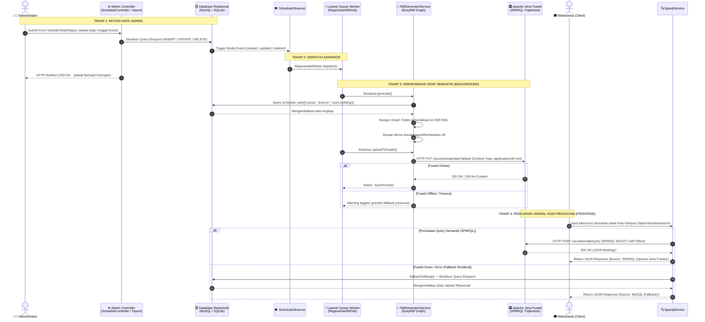

# 🏛️ Dokumentasi Arsitektur & Pemetaan Repositori USUStarterMap
**Disusun oleh:** Senior Software Architect & Lead Laravel Developer  
**Status Proyek:** Production Ready / Advanced Semantic GIS  
**Versi Framework:** Laravel 11.x (PHP 8.2+)  
**Format Dokumen:** Markdown (`.md`)

---

## 1. Ringkasan Proyek

### 1.1. Latar Belakang & Tujuan Umum
**USUStarterMap** adalah platform sistem informasi geografis kampus (Campus Web-GIS) interaktif berbasis **Web Semantik (Semantic Web / Linked Data)** yang dirancang untuk memetakan, mengelola, dan menavigasi jadwal perkuliahan di lingkungan **Universitas Sumatera Utara (USU)**.

Fokus operasional utamanya adalah memecahkan tantangan logistik mahasiswa dan dosen dalam perkuliahan lintas fakultas, khususnya untuk **Mata Kuliah Wajib Kurikulum (MKWK)** dan **Mata Kuliah Wajib Universitas (MKWU)** yang tersebar di puluhan gedung di seluruh kawasan kampus Padang Bulan USU.

### 1.2. Pilar Arsitektur Sistem
Berdasarkan analisis struktur repositori dan basis kode yang telah ditinjau, USUStarterMap dibangun di atas fondasi arsitektur multi-layer:

1. **Enterprise Clean Architecture (Repository Pattern & Service Layer):**
   Memisahkan *presentation layer* (Controllers/Blade), *domain business logic* (Services, Observers, Jobs), dan *data access layer* (Repositories & Eloquent ORM). Ini memastikan kode teruji (*testable*), *maintainable*, dan *loosely coupled*.
2. **Dual-Engine Data Storage (Relational + Graph Database Triplestore):**
   - **Relasional (MySQL / SQLite):** Digunakan sebagai *single source of truth* (SSOT) untuk operasional transaksional ACID, manajemen CRUD admin, otentikasi, relasi multi-tabel, dan bulk import Excel.
   - **Graph Database (Apache Jena Fuseki):** Triplestore RDF yang mengekspos endpoint SPARQL 1.1 untuk pencarian ontologis dan inferensi data relasional (gedung, ruangan, jadwal, dosen, mata kuliah).
   - **Resilient Fallback Mechanism:** `SparqlService` dilengkapi mekanisme *circuit breaker / fallback* otomatis ke query Eloquent MySQL apabila server Jena Fuseki offline atau tidak dapat dijangkau.
3. **Event-Driven Automatic Synchronization:**
   Setiap mutasi data jadwal pada basis data relasional dideteksi oleh `ScheduleObserver`, yang secara asinkron men-dispatch `RegenerateRdfJob` ke antrean (*queue*) untuk meng-generate ulang graf RDF/XML (`EasyRdf`) dan mengunggahnya ke Fuseki melalui *Graph Store Protocol*.
4. **Geospatial & Immersive Media:**
   Integrasi Leaflet.js untuk pemetaan koordinat GPS presisi gedung perkuliahan, rute pejalan kaki Google Maps, dan viewer panorama 360° interaktif (Pannellum / mode silinder) dengan kalibrasi *pitch* dan *yaw* yang tersimpan di triplestore.
5. **Ekosistem Ekstensi Browser & Bulk Ingestion:**
   Dukungan sinkronisasi data jadwal riil dari portal akademik mahasiswa (`satu.usu.ac.id`) via Chrome Extension (`usu-extension`), serta pemrosesan file Excel massal melalui `Maatwebsite/Excel`.

---

## 2. Pemetaan & Penjelasan File per Layer

Berikut adalah rincian fungsional dan teknis dari setiap berkas di dalam repositori USUStarterMap.

```
USUClassMap
 ├── app/
 │    ├── Console/Commands/   -> CLI Artisan Automation
 │    ├── Exports/ & Imports/ -> Excel Batch Processing
 │    ├── Http/Controllers/  -> Presentation & API Layer
 │    ├── Http/Middleware/   -> Security & RBAC Guards
 │    ├── Http/Requests/     -> Form Request Validations
 │    ├── Jobs/              -> Asynchronous Queue Tasks
 │    ├── Models/            -> Domain Entity Relational (Eloquent)
 │    ├── Observers/         -> Domain Model Event Listeners
 │    ├── Providers/         -> Dependency Injection Service Containers
 │    ├── Repositories/      -> Decoupled Data Access Layer (Contracts & Eloquent)
 │    └── Services/          -> Core Business Logic (Semantic & SPARQL)
 ├── config/                 -> Configuration Manifests
 ├── database/               -> Migrations, Seeders, & Raw Geo Datasets
 ├── docs/                   -> System Documentation & Environment Blueprints
 ├── resources/              -> Front-end Views (Blade), Styles (Tailwind), & JS (Leaflet/Alpine)
 └── routes/                 -> Web, API, Auth, & Console Routing Definitions
```

---

### a. Semantic Web & RDF Integration Layer

Layer ini bertanggung jawab atas pemodelan ontologi, serialisasi data relasional menjadi graph triples (RDF/XML), eksekusi query SPARQL, serta sinkronisasi triplestore Apache Jena Fuseki.

#### 1. `app/Console/Commands/GenerateRdfCommand.php`
- **Kategori/Layer:** Console Command (CLI)
- **Fungsi Utama:** Mendefinisikan perintah artisan `php artisan rdf:generate {--upload}`. Berkas ini menginstansiasi `RdfGeneratorService` untuk mengonversi seluruh data jadwal relasional dari database ke file RDF/XML dan secara opsional mengunggahnya langsung ke Apache Jena Fuseki.
- **Kegunaan / Use Case:**
  - Digunakan oleh DevOps/SysAdmin saat deployment awal atau maintenance rutin.
  - Digunakan dalam cron job atau pipeline CI/CD untuk memastikan graph RDF triplestore terisi penuh sebelum aplikasi menerima traffic publik.

#### 2. `app/Jobs/RegenerateRdfJob.php`
- **Kategori/Layer:** Queueable Job (Asynchronous Worker)
- **Fungsi Utama:** Job antrean background yang mengimplementasikan `ShouldQueue`. Bertugas memanggil `RdfGeneratorService::generate()` dan `RdfGeneratorService::uploadToFuseki()` di luar siklus hidup HTTP request utama.
- **Kegunaan / Use Case:**
  - Diterbitkan (*dispatched*) oleh `ScheduleObserver` setiap kali admin membuat, mengedit, atau menghapus jadwal perkuliahan.
  - Memastikan waktu respons antarmuka admin tetap instan (< 100ms) tanpa terhambat oleh proses serialisasi RDF dan HTTP request PUT ke Jena Fuseki.

#### 3. `app/Services/RdfGeneratorService.php`
- **Kategori/Layer:** Domain Service (Semantic Core)
- **Fungsi Utama:** 
  - Memuat entitas `Schedule` beserta relasi `course`, `lecturer`, `room.building` (menggunakan *eager loading* untuk mencegah masalah *N+1 query*).
  - Mengonstruksi graph RDF menggunakan library `EasyRdf\Graph` dengan namespace kustom `usu: http://usuclassmap.usu.ac.id/ontology#` dan resource URI `http://usuclassmap.usu.ac.id/resource/`.
  - Memetakan properti ontologis: `usu:Jadwal`, `usu:MataKuliah`, `usu:Dosen`, `usu:Ruangan`, dan `usu:Gedung`, beserta data properties (`usu:hari`, `usu:jamMulai`, `usu:latitude`, `usu:longitude`, dll).
  - Menyimpan serialisasi format RDF/XML ke path fisik `storage/app/rdf/schedules.rdf`.
  - Mengirim payload RDF/XML ke endpoint Fuseki (`PUT /usuclassmap/data?default`) via HTTP client Laravel dengan timeout terkonfigurasi.
- **Kegunaan / Use Case:**
  - Komponen inti yang menjembatani sistem database relasional MySQL/SQLite dengan paradigma Graph Linked Data.

#### 4. `app/Services/SparqlService.php`
- **Kategori/Layer:** Domain Service (Semantic Search & Resilient Fallback)
- **Fungsi Utama:**
  - Membangun query dinamis `SPARQL SELECT` dengan filter multi-kondisi (`FILTER(CONTAINS(...))`) untuk kata kunci (nama mata kuliah, kode, nama dosen, ruangan, gedung) dan filter hari perkuliahan.
  - Mengirimkan query ke Jena Fuseki endpoint (`POST /usuclassmap/query`) dengan header `Accept: application/sparql-results+json`.
  - Mem-parsing response JSON bindings SPARQL menjadi struktur data array terstandarisasi untuk dikonsumsi frontend.
  - **Auto-Failover Circuit Breaker:** Menyediakan metode `fallbackToMysql()` yang secara transparan mengambil data via Eloquent jika server Fuseki mengalami timeout, down, atau mengembalikan HTTP status non-200.
- **Kegunaan / Use Case:**
  - Dipanggil oleh `ScheduleApiController` saat mahasiswa mencari jadwal perkuliahan melalui bilah pencarian peta. Menjamin aplikasi tetap *high availability* (anti error 500) meski server semantik Fuseki belum aktif.

#### 5. `config/sparql.php`
- **Kategori/Layer:** Configuration Manifest
- **Fungsi Utama:** Menyediakan konfigurasi tersentralisasi untuk Semantic Web: URL host Fuseki (`FUSEKI_URL`), nama dataset (`FUSEKI_DATASET`), endpoint query (`/query`), endpoint data (`/data`), nilai timeout (detik), mapping namespace RDF (`usu`, `rdf`, `rdfs`, `owl`, `xsd`), serta path penyimpanan file ontologi dan RDF.
- **Kegunaan / Use Case:**
  - Memungkinkan konfigurasi environment fleksibel antara mode lokal (Docker/localhost), staging, dan server produksi USU tanpa mengubah baris kode logic.

#### 6. `docs/FUSEKI_SETUP.md`
- **Kategori/Layer:** Technical Documentation & Runbook
- **Fungsi Utama:** Panduan teknis komprehensif untuk instalasi dan eksekusi Apache Jena Fuseki. Mencakup instalasi via Docker container (`stain/jena-fuseki`), standalone Java JAR (JDK 17+), konfigurasi dataset TDB2/In-memory `usuclassmap`, eksekusi perintah sinkronisasi artisan, serta verifikasi endpoint via cURL.
- **Kegunaan / Use Case:**
  - Panduan baku bagi developer baru dan tim infrastruktur untuk menyiapkan lingkungan triplestore lokal maupun server production.

---

### b. Business Logic & Repository Pattern Layer

Layer ini mengabstraksi akses data dari basis data relasional, mengisolasi operasi query SQL/Eloquent, serta menangkap *lifecycle events* model data untuk otomatisasi sinkronisasi.

#### 1. `app/Repositories/Contracts/BaseRepositoryInterface.php`
- **Kategori/Layer:** Contract / Interface
- **Fungsi Utama:** Mendeklarasikan kontrak metode data-access standar CRUD: `all()`, `paginate()`, `find()`, `create()`, `update()`, dan `delete()`.
- **Kegunaan / Use Case:** Menjadi standar (*blueprint*) bagi seluruh repository turunan di dalam sistem untuk konsistensi API internal.

#### 2. `app/Repositories/Contracts/BuildingRepositoryInterface.php`
- **Kategori/Layer:** Contract / Interface
- **Fungsi Utama:** Mendefinisikan kontrak spesifik entitas Gedung, termasuk metode pencarian `search(?string $keyword, int $perPage)`.
- **Kegunaan / Use Case:** Digunakan oleh service container untuk binding abstraksi ke implementasi Eloquent.

#### 3. `app/Repositories/Contracts/CourseRepositoryInterface.php`
- **Kategori/Layer:** Contract / Interface
- **Fungsi Utama:** Mendefinisikan kontrak spesifik entitas Mata Kuliah, termasuk kalkulasi hitungan jadwal (`withCount('schedules')`) dan filter kode/nama.
- **Kegunaan / Use Case:** Abstraksi akses data mata kuliah pada modul manajemen kurikulum.

#### 4. `app/Repositories/Contracts/LecturerRepositoryInterface.php`
- **Kategori/Layer:** Contract / Interface
- **Fungsi Utama:** Mendefinisikan kontrak akses data Dosen dengan query pencarian berbasis NIP, nama, dan email.
- **Kegunaan / Use Case:** Abstraksi query data pengajar di dashboard admin.

#### 5. `app/Repositories/Contracts/RoomRepositoryInterface.php`
- **Kategori/Layer:** Contract / Interface
- **Fungsi Utama:** Mendefinisikan kontrak akses data Ruangan kelas dengan relasi gedung dan kapasitas.
- **Kegunaan / Use Case:** Digunakan dalam pengelolaan inventaris ruangan dan pemetaan spasial.

#### 6. `app/Repositories/Contracts/ScheduleRepositoryInterface.php`
- **Kategori/Layer:** Contract / Interface
- **Fungsi Utama:** Mendefinisikan kontrak pencarian multi-parameter jadwal (`search(?string $keyword, ?string $day, int $perPage)`) dengan relasi lengkap ke dosen, mata kuliah, ruangan, dan gedung.
- **Kegunaan / Use Case:** Abstraksi query relasional jadwal pada backend admin.

#### 7. `app/Repositories/Eloquent/BaseRepository.php`
- **Kategori/Layer:** Repository Implementation (Abstract Class)
- **Fungsi Utama:** Menyediakan implementasi konkret dari `BaseRepositoryInterface` menggunakan instance Eloquent `Illuminate\Database\Eloquent\Model`. Mengotomatisasi pemanggilan query `all()`, `paginate()`, `create()`, `update()`, dan `delete()`.
- **Kegunaan / Use Case:** Kelas induk (*superclass*) yang mewariskan fungsi dasar CRUD ke seluruh kelas repository spesifik, mencegah duplikasi kode (*DRY principle*).

#### 8. `app/Repositories/Eloquent/BuildingRepository.php`
- **Kategori/Layer:** Repository Implementation
- **Fungsi Utama:** Mengimplementasikan `BuildingRepositoryInterface`. Menangani query pencarian nama dan kode gedung beserta agregasi jumlah ruangan (`withCount('rooms')`).
- **Kegunaan / Use Case:** Menyediakan data gedung untuk controller admin.

#### 9. `app/Repositories/Eloquent/CourseRepository.php`
- **Kategori/Layer:** Repository Implementation
- **Fungsi Utama:** Mengimplementasikan `CourseRepositoryInterface`. Menjalankan query pencarian mata kuliah berdasarkan nama atau kode dengan eager load agregasi jadwal.
- **Kegunaan / Use Case:** Menyuplai data mata kuliah untuk tampilan tabel admin dan dropdown form jadwal.

#### 10. `app/Repositories/Eloquent/LecturerRepository.php`
- **Kategori/Layer:** Repository Implementation
- **Fungsi Utama:** Mengimplementasikan `LecturerRepositoryInterface`. Menangani filter data dosen berdasarkan nama, NIP, atau email.
- **Kegunaan / Use Case:** Pencarian dan pengelolaan data dosen pengampu MKWK/MKWU.

#### 11. `app/Repositories/Eloquent/RoomRepository.php`
- **Kategori/Layer:** Repository Implementation
- **Fungsi Utama:** Mengimplementasikan `RoomRepositoryInterface`. Menghubungkan ruangan dengan gedung induknya (`with('building')`) dan menghitung alokasi jadwal.
- **Kegunaan / Use Case:** Pengelolaan data ruangan kelas dan verifikasi keberadaan ruangan saat import data.

#### 12. `app/Repositories/Eloquent/ScheduleRepository.php`
- **Kategori/Layer:** Repository Implementation
- **Fungsi Utama:** Mengimplementasikan `ScheduleRepositoryInterface`. Menangani filter kompleks jadwal perkuliahan dengan *nested relation search* (`whereHas('course')`, `whereHas('lecturer')`, dsb.) dan filter hari.
- **Kegunaan / Use Case:** Sumber data query relasional jadwal pada panel admin dan fallback controller.

#### 13. `app/Observers/ScheduleObserver.php`
- **Kategori/Layer:** Model Observer / Domain Event Listener
- **Fungsi Utama:** Mengamati siklus hidup (*lifecycle hooks*) model `Schedule`. Ketika sebuah record jadwal mengalami event `created`, `updated`, atau `deleted`, observer ini mengeksekusi `RegenerateRdfJob::dispatch()`.
- **Kegunaan / Use Case:**
  - Menjadi jantung sinkronisasi reaktif data: setiap modifikasi pada database MySQL otomatis memicu pembaruan graph RDF di Apache Jena Fuseki tanpa memerlukan intervensi manual admin.

#### 14. `app/Providers/AppServiceProvider.php`
- **Kategori/Layer:** Service Provider (Dependency Injection & Bootstrap)
- **Fungsi Utama:** 
  - Mendaftarkan binding IoC Container antara setiap interface repository dengan kelas implementasinya.
  - Mendaftarkan singleton `RdfGeneratorService` dan `SparqlService`.
  - Mendaftarkan `Schedule::observe(ScheduleObserver::class)` pada method `boot()`.
  - Menyetel konfigurasi pagination bawaan menggunakan Tailwind CSS (`Paginator::useTailwind()`).
- **Kegunaan / Use Case:** Menjamin prinsip *Inversion of Control* (IoC) dan *Dependency Injection* (DI) bekerja sempurna di seluruh aplikasi.

---

### c. Controllers & API Layer

Layer ini bertindak sebagai penerima HTTP Request, mengoordinasikan validasi, memanggil repository atau service terkait, dan merender tampilan Blade atau merespons payload JSON.

#### Sub-layer: Admin Controllers (`app/Http/Controllers/Admin/*`)

1. **`app/Http/Controllers/Admin/DashboardController.php`**
   - **Kategori:** Controller (Admin Portal)
   - **Fungsi Utama:** Menghitung metrik ringkasan sistem (total jadwal, dosen, gedung, ruangan, mata kuliah) dan mengambil 5 jadwal perkuliahan terbaru.
   - **Kegunaan:** Ditampilkan saat administrator pertama kali masuk ke `/admin/dashboard`. Memberikan *high-level overview* kondisi data kampus.

2. **`app/Http/Controllers/Admin/BuildingController.php`**
   - **Kategori:** Resource Controller
   - **Fungsi Utama:** Mengelola alur CRUD entitas gedung kampus (`index`, `create`, `store`, `edit`, `update`, `destroy`) dengan validasi `BuildingRequest`.
   - **Kegunaan:** Digunakan oleh admin untuk menambah gedung baru, mengubah nama/deskripsi, dan memperbarui titik koordinat lintang/bujur (Latitude & Longitude).

3. **`app/Http/Controllers/Admin/RoomController.php`**
   - **Kategori:** Resource Controller
   - **Fungsi Utama:** Menangani CRUD data ruangan kelas beserta asosiasi ke gedung induk, lantai, kapasitas mahasiswa, dan path foto panorama 360°.
   - **Kegunaan:** Menata alokasi ruangan perkuliahan per gedung.

4. **`app/Http/Controllers/Admin/CourseController.php`**
   - **Kategori:** Resource Controller
   - **Fungsi Utama:** Mengelola data mata kuliah: kode mata kuliah, nama, jumlah SKS, dan tipe (MKWU, MKWK, Prodi).
   - **Kegunaan:** Manajemen katalog kurikulum universitas.

5. **`app/Http/Controllers/Admin/LecturerController.php`**
   - **Kategori:** Resource Controller
   - **Fungsi Utama:** Mengelola master data dosen: nama lengkap, NIP, email dinas, dan nomor kontak.
   - **Kegunaan:** Memastikan dosen pengampu terdaftar dengan NIP yang valid untuk referensi jadwal.

6. **`app/Http/Controllers/Admin/ScheduleController.php`**
   - **Kategori:** Resource Controller
   - **Fungsi Utama:** Mengelola CRUD alokasi jadwal perkuliahan: menghubungkan mata kuliah, dosen, ruangan, hari, jam mulai-selesai, semester, dan kelompok kelas.
   - **Kegunaan:** Operasional inti admin akademik. Setiap modifikasi data di controller ini langsung memicu sinkronisasi RDF via `ScheduleObserver`.

7. **`app/Http/Controllers/Admin/ImportController.php`**
   - **Kategori:** Controller (Batch Data Management)
   - **Fungsi Utama:** Menerima file spreadsheet (`.xlsx`, `.xls`, `.csv`), memvalidasi ukuran dan ekstensi, lalu mengeksekusi `ScheduleImport`. Juga menyediakan download template melalui `ScheduleTemplateExport`.
   - **Kegunaan:** Memungkinkan pengelola akademik memasukkan ratusan jadwal kelas sekaligus tanpa input manual satu per satu.

---

#### Sub-layer: API Controllers (`app/Http/Controllers/Api/*`)

1. **`app/Http/Controllers/Api/ScheduleApiController.php`**
   - **Kategori:** RESTful API Controller
   - **Fungsi Utama:**
     - Endpoint `/api/schedules/search`: Menerima query parameter `q` (kata kunci) dan `day` (hari), lalu mendelegasikannya ke `SparqlService::searchSchedules()`.
     - Endpoint `/api/schedule/sync`: Menerima payload sinkronisasi jadwal yang di-scrape oleh Chrome Extension dari portal `satu.usu.ac.id`.
   - **Kegunaan:** Backend API untuk search bar pada peta publik dan integrasi eksternal ekstensi browser mahasiswa.

2. **`app/Http/Controllers/Api/BuildingApiController.php`**
   - **Kategori:** RESTful Geo-API Controller
   - **Fungsi Utama:**
     - Endpoint `/api/buildings`: Mengembalikan seluruh daftar gedung berkoordinat GPS lengkap dengan nested relations ruangan, foto 360°, dan jadwal yang aktif di ruangan tersebut.
     - Melakukan pengecekan kontekstual terhadap user yang sedang login untuk membubuhkan flag `is_my_class` (apakah kelas tersebut milik mahasiswa login berdasarkan semester).
   - **Kegunaan:** Sumber data GeoJSON/JSON utama yang dikonsumsi oleh Leaflet.js (`map.js`) untuk merender pin marker gedung di atas peta kampus Padang Bulan.

---

#### Sub-layer: Controllers Umum & Auth

1. **`app/Http/Controllers/ScheduleController.php` (Umum/Public)**
   - **Kategori:** Controller
   - **Fungsi Utama:**
     - `mySchedules()`: Mengembalikan seluruh jadwal kampus dengan penandaan dinamis `is_my_class` berdasarkan profil semester mahasiswa yang terotentikasi, lengkap dengan ringkasan jumlah kelas per gedung.
     - `sync()`: Menangani penerimaan data jadwal dari ekstensi browser mahasiswa.
   - **Kegunaan:** Mendukung fitur personalisasi jadwal mahasiswa pada peta Leaflet.

2. **`app/Http/Controllers/AdminMapController.php`**
   - **Kategori:** Controller (Spatial Admin Workbench)
   - **Fungsi Utama:** 
     - Menyediakan antarmuka visual terpadu untuk plotting pin gedung langsung di peta dengan marker yang dapat digeser (*draggable Leaflet marker*).
     - Menangani operasi AJAX untuk pembuatan gedung, ruangan, media multimedia (foto, video POV, 360° scene), dan jadwal langsung dari tampilan spasial.
   - **Kegunaan:** Memudahkan admin memposisikan koordinat gedung secara visual tanpa harus menyalin angka Latitude/Longitude manual dari Google Maps.

3. **`app/Http/Controllers/PhotoInspectorController.php`**
   - **Kategori:** Controller (360° Visual Calibration & Semantic Updater)
   - **Fungsi Utama:**
     - `index()` & `indexCylinder()`: Memindai folder penyimpanan fisik (`storage/app/public/foto360` dan `foto360p`), lalu menggabungkannya dengan data sudut pandang awal (*initial pitch & yaw*) yang diambil langsung dari triplestore Jena Fuseki via `SPARQL SELECT`.
     - `saveCalibration()`: Menerima kalibrasi *pitch* dan *yaw* dari frontend Pannellum, lalu mengeksekusi **SPARQL Update** (`DELETE ... INSERT ... WHERE ...`) langsung ke Apache Jena Fuseki endpoint.
   - **Kegunaan:** Alat kalibrasi sudut pandang tur 360° ruangan kelas agar saat pertama kali dibuka oleh mahasiswa, kamera panorama langsung menghadap ke papan tulis atau pintu masuk yang tepat.

4. **`app/Http/Controllers/FaqController.php`**
   - **Kategori:** Public Informational Controller
   - **Fungsi Utama:** Menyusun daftar tanya-jawab interaktif terstruktur mengenai penggunaan peta, pencarian jadwal, tur 360°, petunjuk arah pejalan kaki, bookmark, dan teknologi Web Semantik USUStarterMap.
   - **Kegunaan:** Merender halaman `/faq` untuk membantu civitas akademika memahami fitur sistem.

5. **`app/Http/Controllers/ProfileController.php`**
   - **Kategori:** User Account Controller (Laravel Breeze)
   - **Fungsi Utama:** Mengelola pembaruan nama, email, password, dan penghapusan akun mahasiswa.
   - **Kegunaan:** Manajemen preferensi akun pengguna terotentikasi.

6. **`app/Http/Controllers/Auth/*` (Breeze Authentication Suite)**
   - **Berkas Terkait:** `AuthenticatedSessionController.php`, `RegisteredUserController.php`, `PasswordResetLinkController.php`, `NewPasswordController.php`, `PasswordController.php`, `VerifyEmailController.php`, `EmailVerificationNotificationController.php`, `EmailVerificationPromptController.php`, `ConfirmablePasswordController.php`, dan `LoginController.php`.
   - **Kategori:** Security & Identity Management
   - **Fungsi Utama:** Mengatur seluruh alur otentikasi standar: registrasi pengguna baru dengan field khusus NIM dan semester, sesi login berbasis cookie terenkripsi, pengingat kata sandi, dan proteksi brute force (*rate limiting*).
   - **Kegunaan:** Membedakan hak akses antara mahasiswa umum (`role: 'user'`) dengan staf pengelola (`role: 'admin'` / `'superadmin'`).

---

### d. Data Layer (Models, Migrations & Seeders)

Layer ini mengatur definisi skema data relasional, integritas referensial (foreign keys), indeks performa, serta dataset awal kampus USU.

#### 1. Models (`app/Models/*`)

- **`User.php`**: Entitas pengguna. Memiliki atribut `name`, `email`, `nim`, `semester`, `password`, dan `role`. Dilengkapi helper `isAdmin()`, `isSuperAdmin()`, dan query scope `scopeAdmins()`.
- **`Building.php`**: Entitas gedung kampus. Menyimpan `name`, `code` (unik), `faculty`, `category`, `latitude`, `longitude`, `floor_count`, dan `description`. Memiliki relasi `hasMany(Room::class)`.
- **`Room.php`**: Entitas ruangan kelas. Menyimpan `building_id`, `name`, `floor`, `capacity`, dan `photo_360_path`. Memiliki relasi `belongsTo(Building::class)`, `hasMany(Schedule::class)`, dan `hasMany(RoomMedia::class)`.
- **`RoomMedia.php`**: Entitas media imersif ruangan (Phase 7.3). Mendukung tipe `photo`, `360`, dan `video`. Menyimpan kolom JSON `metadata` (hotspot, yaw, pitch) dan accessor `file_url`.
- **`Course.php`**: Entitas mata kuliah. Menyimpan `code` (unik), `name`, `credits` (SKS), dan `type` (MKWU/MKWK/Prodi). Berelasi `hasMany(Schedule::class)`.
- **`Lecturer.php`**: Entitas dosen. Menyimpan `name`, `nip` (unik), `email`, dan `phone`. Berelasi `hasMany(Schedule::class)`.
- **`Schedule.php`**: Entitas pusat perkuliahan. Mengombinasikan `course_id`, `lecturer_id`, `room_id`, `day`, `time_start`, `time_end`, `semester`, dan `class_group`. Memiliki accessor `full_schedule_label`.

---

#### 2. Migrations (`database/migrations/*`)

1. `0001_01_01_000000_create_users_table.php`: Skema default users, password resets, dan sessions.
2. `0001_01_01_000001_create_cache_table.php`: Tabel cache sistem.
3. `0001_01_01_000002_create_jobs_table.php`: Tabel queue jobs dan failed jobs untuk eksekusi asinkron `RegenerateRdfJob`.
4. `2026_08_24_000001_add_role_to_users_table.php`: Menambahkan kolom enum `role` ('superadmin', 'admin', 'user') pada tabel users.
5. `2026_08_24_000002_create_buildings_table.php`: Membuat tabel `buildings` dengan koordinat desimal presisi tinggi (`latitude` & `longitude` decimal 10,8).
6. `2026_08_24_000003_create_rooms_table.php`: Membuat tabel `rooms` dengan foreign key `building_id` cascade on delete.
7. `2026_08_24_000004_create_lecturers_table.php`: Membuat tabel `lecturers` untuk menyimpan data pengajar.
8. `2026_08_24_000005_create_courses_table.php`: Membuat tabel `courses` untuk data mata kuliah.
9. `2026_08_24_000006_create_schedules_table.php`: Membuat tabel relasi `schedules` yang mengikat `course_id`, `lecturer_id`, dan `room_id` dengan foreign key berindeks.
10. `2026_08_24_000007_add_indexes_for_performance_optimization.php`: Menambahkan indeks komposit pada `schedules(['day', 'time_start'])`, indeks pada `courses('type')`, dan `lecturers('name')` untuk mempercepat query search.
11. `2026_08_25_000001_add_nim_and_semester_to_users_table.php`: Menambahkan kolom identitas mahasiswa `nim` dan `semester` pada `users`.
12. `2026_08_31_000001_create_room_media_table.php`: Membuat tabel `room_media` beserta indeks komposit `['room_id', 'type']` untuk manajemen multimedia ruangan.

---

#### 3. Seeders & Raw Data (`database/seeders/*`)

- **`DatabaseSeeder.php`**: Master runner yang memanggil seeder secara berurutan: `AdminUserSeeder`, `BuildingSeeder`, `RoomSeeder`, `LecturerSeeder`, `CourseSeeder`, `ScheduleSeeder`, dan `FibDummySeeder`.
- **`AdminUserSeeder.php`**: Membuat akun default Super Admin (`admin@usu.ac.id` / `Admin123!`) dan akun demo mahasiswa Daffa Umayans Saragih (`daffa@students.usu.ac.id` / `Password123!`).
- **`BuildingSeeder.php`**: Mengisi 46 gedung otentik kampus USU yang diekstrak secara presisi dari OpenStreetMap (OSM) Overpass API, mencakup Rektorat, GKB, Perpustakaan, Fasilkom-TI, Fakultas Teknik, Kedokteran, FIB, dsb.
- **`RoomSeeder.php`**: Mengisi data puluhan ruangan kelas standar (GK1, GK2, lab Fasilkom, amphitheater FK, ruang tutorial PBL).
- **`CourseSeeder.php`**: Mengisi kurikulum mata kuliah wajib (Agama, Pancasila, Kewarganegaraan, Bahasa Indonesia, Etika Digital) dan prodi Ilmu Komputer/TI (Web Semantik, Basis Data, AI).
- **`LecturerSeeder.php`**: Mengisi puluhan data dosen pengampu bergelar lengkap beserta NIP dinas.
- **`ScheduleSeeder.php`**: Menghubungkan mata kuliah, dosen, dan ruangan menjadi jadwal perkuliahan hari Senin hingga Sabtu.
- **`FibDummySeeder.php`**: Dataset hardcoded khusus 100 jadwal perkuliahan MKWU/Fakultas Ilmu Budaya (FIB) untuk pengujian beban dan visualisasi padat.
- **`MkwuFasilkomSeeder.php`**: Seeder alternatif untuk memetakan jadwal perkuliahan MKWU khusus mahasiswa FASILKOM-TI.
- **`raw_osm_buildings.json`**: Dataset mentah koordinat poligon/titik tengah gedung kampus USU hasil ekstraksi OpenStreetMap.
- **`raw_usu_buildings.json`**: Dataset pelengkap informasi fasilitas umum di dalam kawasan universitas.
- **`database/seeders/data/mkwu.csv`**: File tabular data mentah jadwal perkuliahan MKWU semester berjalan yang menjadi acuan import data massal.

---

### e. Impor & Ekspor Layer

Layer ini bertugas memfasilitasi pertukaran data massal antara format spreadsheet perkantoran dengan model data relasional sistem.

#### 1. `app/Imports/ScheduleImport.php`
- **Kategori/Layer:** Batch Importer (Maatwebsite Excel)
- **Fungsi Utama:**
  - Mengimplementasikan interface `ToModel`, `WithHeadingRow`, `WithValidation`, dan `SkipsOnError`.
  - Membaca baris spreadsheet Excel/CSV: mencari atau secara otomatis membuat (*auto firstOrCreate*) data Mata Kuliah (`Course`) dan Dosen (`Lecturer`).
  - Mencocokkan nama ruangan (`Room`): jika nama ruangan tidak ditemukan dalam database gedung, baris ditolak dan dicatat ke dalam log error tanpa menggagalkan baris lainnya.
  - Memvalidasi format hari (Senin-Sabtu), jam kuliah, dan kelengkapan kolom wajib.
- **Kegunaan / Use Case:** Dipanggil oleh `Admin\ImportController` saat admin mengunggah file jadwal perkuliahan baru tiap awal semester.

#### 2. `app/Exports/ScheduleTemplateExport.php`
- **Kategori/Layer:** Template Exporter (Maatwebsite Excel)
- **Fungsi Utama:**
  - Mengimplementasikan `FromArray` dan `WithHeadings`.
  - Menghasilkan file Excel baku dengan baris header: `kode_mk`, `nama_mk`, `sks`, `tipe_mk`, `nama_dosen`, `nama_ruangan`, `hari`, `jam_mulai`, `jam_selesai`, `semester`, dan `kelompok_kelas`.
  - Menyertakan 3 contoh baris data siap pakai sebagai petunjuk input admin.
- **Kegunaan / Use Case:** Diunduh oleh staf admin fakultas melalui tombol "Download Template" di panel impor agar format data yang akan diunggah sesuai dengan skema sistem.

---

### f. Konfigurasi, Routing & Build Tools Layer

Layer ini menyediakan konfigurasi runtime, pendefinisian rute HTTP, serta orchestrator bundling aset frontend.

#### 1. File Konfigurasi Environment (`.env` & `.env.example`)
- **Fungsi Utama:** Menyimpan variabel lingkungan sensitif: `APP_NAME="USUStarterMap"`, koneksi database (`DB_CONNECTION=sqlite` untuk dev, `mysql` untuk prod), driver queue (`QUEUE_CONNECTION=database`), serta konfigurasi Semantic Web Fuseki (`SPARQL_ENDPOINT=http://localhost:3030/usuclassmap/query`, `SPARQL_TIMEOUT=5`).
- **Kegunaan:** Menjaga kredensial tetap aman di luar version control git dan mempermudah deployment multi-environment.

#### 2. Routing (`routes/*`)
- **`routes/web.php`**: Mendefinisikan seluruh rute antarmuka publik (`/`, `/map`, `/bookmarks`, `/faq`), rute profil pengguna, rute kalibrasi foto 360° (`/admin/cek-foto`), panel admin spasial (`/admin-sementara-/map`), serta grup rute Resource Admin bertameng middleware `['auth', 'admin']`.
- **`routes/api.php`**: Mendefinisikan rute stateless: pencarian jadwal semantik (`/api/schedules/search`), direktori gedung berkoordinat (`/api/buildings`), dan webhook sinkronisasi ekstensi browser (`/api/schedule/sync`).
- **`routes/auth.php`**: Rute autentikasi Laravel Breeze untuk login, register, lupa sandi, dan logout.
- **`routes/console.php`**: Rute perintah konsol berbasis closure (misal: perintah `inspire`).

#### 3. Middleware (`app/Http/Middleware/EnsureUserIsAdmin.php`)
- **Fungsi Utama:** Memeriksa apakah pengguna yang mengakses rute telah login dan memiliki method `isAdmin() === true` (role 'admin' atau 'superadmin'). Jika tidak berhak, me-redirect pengguna ke halaman login dengan pesan error akses ditolak.
- **Kegunaan:** Guard keamanan RBAC (*Role-Based Access Control*) untuk seluruh rute berawalan `/admin/*`.

#### 4. Paket & Build Tools (`package.json`, `composer.json`, `vite.config.js`, `tailwind.config.js`)
- **`composer.json`**: Mengelola dependensi PHP: `laravel/framework 11.x`, `easyrdf/easyrdf 1.1` (semantic graph engine), `maatwebsite/excel 3.1`, dan `laravel/breeze`.
- **`package.json`**: Mengelola dependensi frontend: `tailwindcss 4.x`, `@tailwindcss/forms`, `alpinejs 3.x`, `axios`, dan build tool `vite 6.x`.
- **`vite.config.js`**: Mengonfigurasi plugin Laravel Vite untuk hot-reloading dan kompilasi aset `resources/css/app.css` dan `resources/js/app.js`.
- **`tailwind.config.js`**: Menentukan custom palet identitas resmi USU (`usu-green: #10A760`, `usu-gold: #D4A017`, dll.), font keluarga `Inter`, serta konfigurasi scanner view Blade.

---

## 3. Diagram Alur Kerja Data (Workflow Architecture)

Berikut adalah diagram alur data komprehensif yang menggambarkan siklus hidup data: mulai dari mutasi data relasional di panel admin, sinkronisasi event-driven ke format RDF, upload ke Fuseki Triplestore, hingga pencarian semantik bergaransi fallback oleh mahasiswa.



---

## 4. Kesimpulan & Rekomendasi Arsitektur

Arsitektur repositori **USUStarterMap** menunjukkan kematangan desain perangkat lunak yang sangat tinggi (*enterprise-grade*) dengan menerapkan prinsip-prinsip:
1. **Separation of Concerns (SoC):** Pemisahan tegas antara routing, controller, validasi request, repository, service domain, dan model event listeners.
2. **Resilience & Fault Tolerance:** Implementasi graceful degradation pada `SparqlService` memastikan bahwa kegagalan service semantik Fuseki tidak pernah mengakibatkan downtime pada aplikasi web publik.
3. **Optimized I/O:** Serialisasi RDF dilakukan secara asinkron melalui antrean worker, menjaga fluiditas pengalaman pengguna admin saat memanipulasi data berskala besar.
4. **Extensibility:** Pola Repository Pattern yang diterapkan membuka fleksibilitas pengujian (*unit/feature testing*) dengan mock data serta mempermudah migrasi database di masa mendatang tanpa merombak logika controller.

Dokumentasi ini siap dijadikan referensi teknis utama bagi tim pengembang, akademisi, dan pengelola sistem USUStarterMap.

